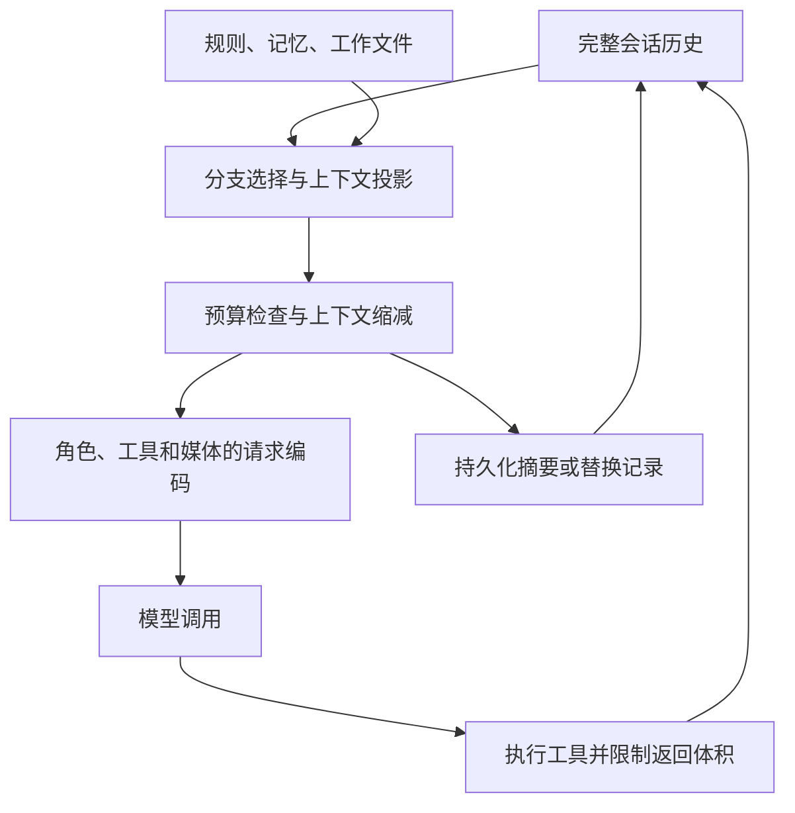

# Agent 的上下文管理：Codex、Claude Code、dsh 与 pi 的机制和算法

一个 coding agent 接到任务后，可能先读项目规则，再查十几个文件、修改代码、执行测试，接着根据失败日志换一种方案。几十轮工具调用以后，最初的需求仍然重要，旧文件内容已经过时，大部分日志不值得再读，但某次失败排除掉的方案又不能丢。

上下文管理要解决的，就是下一次模型请求到底应该携带哪些信息。

这件事比“快满了就总结一下”复杂。系统要先区分完整历史与当前工作状态，限制工具结果的体积，估计剩余预算，找到不会拆坏工具调用的压缩边界；摘要生成后，还要恢复规则与工作材料，处理生成摘要期间新到的消息。如果这些环节没有接好，模型即使拿到一篇流畅的摘要，也可能继续做错事。

本文比较 **Codex 开源 harness、Claude Code、DeepSeek Harness（dsh）和 pi coding-agent**。关注的是 harness 怎样管理模型输入，不讨论模型内部的 KV cache 淘汰、注意力稀疏化或权重量化。服务端 prompt caching 会影响策略成本，但它与客户端选择上下文是两个层次。

## 调研范围与版本

资料核验日期为 **2026-11-05**。三个开源项目均下载固定提交的源码，沿上下文构造、压缩、持久化和重试路径阅读，并核对相关测试。本文没有运行在线模型任务评测，后面的取舍分析不构成完成率排名。

| 对象        | 本文固定的依据                                                                                                                         | 证据范围                                                                         |
| ----------- | -------------------------------------------------------------------------------------------------------------------------------------- | -------------------------------------------------------------------------------- |
| Codex       | [`ba057e43758c`](https://github.com/openai/codex/tree/ba057e43758cb19beead2af9df19d10756cc4100)                                        | 客户端源码可检查；远端压缩状态的内部编码未公开                                   |
| dsh         | [`fcc0ad462172`](https://github.com/deepseek-ai/deepseek-harness/tree/fcc0ad462172522aaf5c93a7b2e01f6b9f0b0159)，版本字段 `0.2.2-rc.1` | token meter、裁剪、摘要和事件替换源码可检查                                      |
| pi          | [`386db6130e42`](https://github.com/earendil-works/pi/tree/386db6130e42e1035640782e35bfb98a59fd9904)，coding-agent 版本字段 `1.5.0`    | 以 `AgentSession` 对接的 coding-agent 路径为主                                   |
| Claude Code | 当日官方产品文档、工程文章及 Claude API 文档                                                                                           | 本次未获得可核验的官方完整运行时源码；只描述披露的行为，不据此补造内部函数与算法 |

主分支提交不等于已发布版本，功能开关也会改变实际路径。例如，本文 Codex 快照中的后台压缩仍处于开发阶段，源码默认关闭。本文涉及的 Claude API beta 功能，也不自动等于 Claude Code 正在使用的内部协议。

已有的 [Pi 上下文管理笔记](./pi-context-management)和 [DeepSeek Harness 整体调研](./deepseek-harness-codebase-research)保留了较早的版本观察。本文中的数值和流程以本次快照为准。

## 1. 从历史到请求，中间有一层工作视图

先把几个容易混用的对象分开：

| 对象               | 保存什么                                           | 主要用途                 |
| ------------------ | -------------------------------------------------- | ------------------------ |
| 持久历史           | 用户消息、工具调用、结果、摘要与状态事件           | 恢复、追查、分支导航     |
| 当前上下文投影     | 当前分支中仍然有效、仍应交给模型的内容             | 选择下一步工作的依据     |
| 最终请求           | 投影经过角色转换、工具声明和 provider 编码后的输入 | 实际模型推理             |
| 外部记忆与工作材料 | 规则文件、项目文档、记忆文件、代码和日志归档       | 在后续请求中按需重新读取 |

pi 的 `buildSessionProjection()` 和 dsh 的 session surface 都直接体现了这种区分：原始记录可以继续留在存储中，而模型只看到摘要、保留消息及后来追加的内容。Codex 的 context manager 同样维护供请求使用的历史，并在构造请求时处理截断、工具配对和媒体兼容性。[^pi-projection][^dsh-surface][^codex-history]



因此，一次压缩可以改变工作视图，同时保留此前发生过什么。反过来，即使磁盘上保存了完整 JSONL，也不能据此判断模型仍然记得其中的细节；必须检查本次请求的投影。

从算法上，可以把这个过程写成：

$$
C_t = \operatorname{Encode}\bigl(\operatorname{Project}(H_t, b_t, e_t), I_t, D_t\bigr)
$$

其中，$H_t$ 是持久历史，$b_t$ 是当前分支或有效前缀，$e_t$ 是压缩与编辑记录，$I_t$ 是规则和环境信息，$D_t$ 是当前工具声明。这个公式是本文的分析抽象，不是四个项目共同实现的接口。

它揭示了一个经常被忽略的问题：**上下文是否正确，既取决于保留了多少内容，也取决于这些内容属于哪个版本、分支和执行时刻。** “测试已经通过”如果对应修改前的代码，保留得再完整也会误导下一步。

### 预算约束之外，还有结构约束

一个简化的窗口约束是：

$$
T_{\mathrm{rules}} + T_{\mathrm{tools}} + T_{\mathrm{messages}}
+ R_{\mathrm{output}} + M_{\mathrm{safety}} \le W
$$

这里 $W$ 是模型窗口，$R_{\mathrm{output}}$ 是回复预算，$M_{\mathrm{safety}}$ 是估算误差和下一批输入需要的余量。不同 provider 对 thinking、图片和 usage 的记账方式不同，实际实现还要遵守对应协议。

但“总 token 数符合要求”仍然不够。下面这段历史不能随便从中间切开：

```text
assistant: 调用 read("config.ts")，call_id = A
tool: A 的文件内容
assistant: 根据文件提出修改
```

如果仅保留工具结果，provider 可能拒绝孤立结果；如果仅保留调用，模型又可能以为工具尚未完成。pi 禁止把保留区间的切点放在 tool result 上；dsh 显式检查切点前后的工具配对平衡；Codex 的 normalization 会补齐缺失结果并清理孤立结果。它们处理的位置不同，但都在维护可继续执行的请求结构。[^pi-cut][^dsh-pairing][^codex-normalize]

## 2. pi：近期原文、递归摘要与会话树

pi 很适合作为理解基本算法的起点。它将策略暴露成了容易检查的几步：从 session 构造投影，判断预算，选择保留边界，生成摘要，再追加新的压缩记录。

### 2.1 先投影，再估算

session 记录通过 `id` 和 `parentId` 连接成树。`buildSessionPath()` 取出当前 leaf 的祖先路径，`buildContextEntries()` 找出这条路径上最近一次 compaction，重建为压缩记录、此前仍需保留的尾部以及压缩后新追加的条目。`buildSessionProjection()` 再应用当前路径里的 `context_edit`：可以替换一条消息的内容，也可以让它不再进入模型上下文。[^pi-projection]

这使“撤掉一次失败响应”和“删除历史记录”成为不同操作。被省略的响应仍可以出现在审计、导出或历史检索中，但不必继续占据模型窗口。

压缩记录还保存边界处完整的 `systemMessage`，包含当时的 prompt 与工具状态。重建时以这个 checkpoint 接上摘要，旧保留区间里的 system entries 不再重复加入。这让规则与工具状态的恢复有独立依据，不需要全部寄托在自然语言摘要上。[^pi-system-checkpoint]

token 估算通常以最近一次有效 assistant usage 为锚点，加上其后新增消息的估算量：

$$
\widehat T_t = U_k + \sum_{i>k}\widehat T(m_i)
$$

如果找不到有效 usage，就估算整个投影。错误、取消和全零 usage 不作为可靠锚点；如果在 usage 之后发生了上下文编辑或压缩，旧 usage 已不对应当前投影，`estimateProjectedContextTokens()` 会回退到重新估算。这里的文本估算采用字符数近似，不能当作精确 tokenizer 或账单。[^pi-budget]

这一点比具体采用几字符一个 token 更关键：**历史被改写后，统计基线也必须失效或校正。** 否则已经裁掉的日志还会留在计数里，或者已恢复的内容没有被计入。

### 2.2 触发与保留是两个独立参数

本次快照的默认设置是：

```json
{
  "compaction": {
    "enabled": true,
    "reserveTokens": 16384,
    "keepRecentTokens": 20000
  }
}
```

触发条件为：

$$
\widehat T_{\mathrm{context}} > W - \texttt{reserveTokens}
$$

`reserveTokens` 决定什么时候开始压缩；`keepRecentTokens` 决定大约保留多少近期原文。这两个参数没有规定摘要一定生成多长。当前 `generateSummaryWithUsage()` 已不再用传入的 reserve 值设置摘要输出上限，摘要调用走模型输出限制及底层请求预算处理。不能把早期版本的摘要 cap 公式直接套到当前版本。[^pi-budget][^pi-summary][^pi-output-budget]

检查发生在新 prompt、继续生成下一轮 assistant 回复及运行结束后的恢复路径等位置。工具结果已追加、还要继续调用模型时，pi 可以先压缩，再进入下一轮；如果工具批次结束后整个 run 已经完成，也没有排队消息，就没有必要为一个不会立即发生的回复做相同检查。[^pi-lifecycle]

### 2.3 切点算法保留什么

默认策略可以概括成下面的伪代码；实际实现还处理了 context edit 和恢复记录：

```text
projected = 当前分支的规范上下文投影
从末尾向前累计估算 token，直到达到 keepRecentTokens
把边界调整到合法消息入口，避免从 tool result 开始

若边界落在一次用户请求引出的长消息段内部：
    分别总结更早历史和该消息段的前半段
否则：
    总结保留边界之前的历史

把旧摘要、新历史与文件操作记录合并进新摘要
追加 CompactionEntry(summary, firstKeptEntryId, ...)
下一次请求使用新摘要、保留尾部和后续新消息
```

这里的 split turn 指由用户消息或等效上下文入口开始的连续工作段被切开，并不表示把一个 JSON tool call 的字符串拆成两半。源码还把 `bashExecution`、custom 和分支摘要等消息视为可开始工作段的入口。保留区间仍以消息与 entry 边界为单位；`compact()` 在需要时分别生成历史摘要和当前长段的前缀摘要，再将两者合并。[^pi-cut][^pi-summary]

摘要更新通常只需要“上一版摘要 + 新进入压缩区间的内容”。这样不必每次从原始历史起点重读，但压缩也变成了递归过程：早期事实经过后续摘要时，依赖的是此前保留下来的表达。

pi 还把 `read`、`write`、`edit` 的文件操作，以及 codemode 记录的嵌套调用，提取成累计文件清单。已修改文件与只读取文件分别附在摘要后面。这是从可识别工具记录中确定性提取的辅助信息，能减少模型凭文字摘要猜测文件范围的负担；它并不覆盖任意 shell 脚本造成的所有文件变化。[^pi-serialization]

### 2.4 摘要模型看见的内容也经过处理

pi 把待总结消息转成带角色标记的文本，交给独立摘要请求。当前序列化会省略 thinking，并将每条工具结果的文本截到前 2,000 个 UTF-16 代码单元，再附上截断提示。这里使用 JavaScript 的字符串长度和 `slice()`，与 dsh 按 Unicode code point 裁剪的单位不同。摘要请求设置 `cacheRetention: "none"`，避免为这种一次性输入写入 prompt cache。[^pi-serialization][^pi-summary]

因此，摘要的上限不仅来自摘要模型的能力，也来自它实际读到了什么。假设一次测试的真正失败原因位于长日志尾部，而没有被后续 assistant 文字提炼出来，那么摘要请求未必能看到这个原因。指望“换一个更强的摘要模型”解决所有丢失，忽略了输入裁剪这一层。

溢出恢复则使用另一条明确路径：对选中的失败或可恢复截断响应，先追加持久化 omission，使它退出模型投影，再压缩，成功后进行一次 compact-and-retry。若响应本身已成功完成，只是用量超过配置窗口，则压缩而不重复完成的响应。普通网络重试和这种上下文恢复承担不同职责。[^pi-lifecycle]

### 2.5 分支摘要解决的是换方案

`/tree` 导航会找旧 leaf 与目标节点的最近共同祖先，收集离开分支上的工作，在预算内生成 `BranchSummaryEntry`，把旧方案的进展带到目标分支。

```text
共同祖先 A
├── B：方案一 → C：修改 → D：失败原因
└── E：方案二 → F：继续工作 → [B、C、D 的摘要]
```

分支摘要的输入选择也与普通 compaction 不同：`prepareBranchEntries()` 从新到旧选取消息，`getMessageFromEntry()` 直接跳过 tool result，保留可提取的 assistant 文本、工具调用等材料。因此，普通 compaction 中“工具结果先截到 2,000 个代码单元”的规则，不能套用来描述分支摘要；某个失败原因若只出现在工具结果里，也可能没有进入这次摘要输入。[^pi-branch]

这与“同一分支太长”的 compaction 是两个问题。前者决定旧方案哪些经验值得带走，后者决定当前路径哪些历史不必原样携带。分支摘要仍不负责回滚代码目录，工作区状态要由 Git 等机制管理。[^pi-branch]

pi 的整体取舍是：提供清晰的投影、结构化摘要和扩展入口，让策略可以替换。代价也很具体：近期性只是相关性的近似，递归摘要会积累信息损失，而自定义 context hook 若随意删消息，仍可能破坏工具配对或统计基线。

## 3. dsh：先裁剪，再把压缩作为事件替换提交

dsh 同样采用“较早内容摘要 + 近期原文”，但它把计量、裁剪、摘要后端和人工命令拆成独立能力。最有辨识度的部分，是用同一套 session surface 表达上下文替换，并记录这些替换从哪里来。

进入这条历史的规则也有预算。`agent-instructions` 将用户全局规则和项目规则作为持久消息注入，base 配置对两条规则链分别给出 65,536 字节预算；超限时先省略较宽范围的文件，必要时再截断最具体的文件。成功的结构化 `read`、`write`、`edit` 会触发更深目录规则的发现及变化协调，任意 shell 导航并不等价于这个刷新入口。它体现了“规则按作用范围加载”，同时明确了发现新规则所依赖的事件。[^dsh-instructions]

### 3.1 token meter 计量的是当前请求

`ctx.tokenMeter.measure()` 结合当前 surface、规范请求头和最近的 usage 锚点计算压力。在请求 envelope 相同且 usage 满足复用条件时，以锚点用量为基线，叠加当前 surface 相对锚点的有符号变化；工具、路由或调用配置变化使锚点不再适用时，回退到完整估算。[^dsh-meter]

可以把主要思想写成：

$$
\widehat T_{\mathrm{now}}
= T_{\mathrm{baseline}}
+ \widehat T(S_{\mathrm{now}})
- \widehat T(S_{\mathrm{anchor}})
$$

当前实现还检查 provider usage 是否至少覆盖匹配锚点的估算价格。文本采用四字符一个 token 加结构开销的启发式；声明了图片请求定价的路由会使用路由对应的图片计量。因此，这是一套可重放、内部一致的压力估计，不是所有输入都经过精确 tokenizer。[^dsh-meter]

与只做“usage 加新消息”相比，有符号变化自然容纳了替换和裁剪：旧节点被更短节点取代时，压力可以下降。

### 3.2 默认触发公式预留了摘要余量

令 $W$ 为路由模型窗口，$O$ 为当前请求有效输出预留，$B$ 为额外 headroom，$\alpha$ 为触发比例。`resolveCompactSpec()` 计算：

$$
T_{\mathrm{trigger}} = \left\lfloor\min(\alpha W,\ W-O-B)\right\rfloor
$$

默认 $\alpha=0.8$，$B=65,536$。近期原文预算默认是：

$$
K=\left\lfloor 0.16(W-O)\right\rfloor
$$

也可以用绝对 `retainTokens` 覆盖比例。超过或达到触发阈值后才进入正常压力处理。小窗口模型需要调小 headroom，否则扣除输出与 headroom 后可能根本没有合法预算。[^dsh-config]

例如，**仅为演示公式**，设 $W=256,000$、$O=32,000$，则默认触发值为 `158464`，保留预算为 `35840`。直接把它概括成“80% 才压缩”会漏掉另一个更紧的约束。

### 3.3 裁剪不需要模型，也可能已经够用

当压力条件成立，若挂载了 tool-result pruner，dsh 先对当前 surface 的超长工具结果做确定性裁剪。默认阈值是 8,192 个 Unicode code point；超过后保留开头 4,096、末尾 1,024，中间换成标记，非文本 block 的顺序保留。这里的单位是字符码点，不是 token。[^dsh-pruner]

```text
工具结果： [前 4096 字符] [裁剪标记] [后 1024 字符]
```

它会追加新的替换事件，保留原工具调用身份和来源引用。重新计量后若压力已经低于阈值，就跳过 LLM 摘要。这种两阶段设计把便宜、可预测的缩减放在前面，避免每次都为大量可丢弃日志支付摘要调用。[^dsh-pressure]

但 head/tail 规则也有清楚的盲区：中间的唯一错误可能被删掉。它适合减少大段工具输出，不等于理解了输出的语义，也不承诺所有原始内容都能通过给模型的裁剪标记找回。

### 3.4 摘要替换按 surface 位置提交

裁剪仍不足时，dsh 从尾部累计 token，保留近期节点，再将边界向前调整到工具配对平衡的位置。最前面的 system 节点不进入摘要替换区间；后续历史里的 system 更新需要结合 agent loop 的当前 system 投影处理。[^dsh-region]

这套系统同时存在两种顺序：

- **事件追加顺序**：持久日志的 seq 一直向后增长。
- **模型可见顺序**：新摘要占据旧区间的位置，后面仍接保留的旧节点。

假设旧 surface 是 `[10, 11, 12, 13]`，新事件 `30` 替换前两个节点，新 surface 就是 `[30, 12, 13]`。下一次替换的边界可以从 `30` 到 `12`，它表达的是位置区间，不能按数值大小筛选日志。`shadowedSeqs` 记录被遮蔽节点的实际顺序。[^dsh-surface]

一次正常摘要操作大致是：

```text
校验选中区间与压缩锁
→ 追加 compaction/start
→ 请求摘要
→ 验证带包装的摘要确实更短
→ 比对当前 surface 的节点与计价快照
→ 追加 compaction/summary
→ 追加携带 surfaceOp.replace 的 user/message
→ 追加 compaction/end
```

`compaction/summary` 保存摘要、来源、用量等信息，本身不作为对话消息进入模型；真正改变模型视图的是后面的 replacement `user/message`。自动路径提交前比对整个 surface 的节点序列与价格快照；idle 状态下的手动路径只比对选中区间的节点身份、连续性、配对状态和价格，区间外新追加的上下文可以保留。这里描述的是实现实际执行的检查，并不是逐字节比较全部消息内容。[^dsh-region]

这里所谓“事务”是应用层的事件协议：`start` 形成持久锁，`end` 释放；异常中断可以留下可检测的未闭合记录。它不意味着磁盘存储自动提供了一个覆盖全部事件的数据库 ACID 事务。

### 3.5 重试需要已经改变输入的证据

provider 确认 `CONTEXT_WINDOW_EXCEEDED` 后，dsh 会绕过普通压力与保留策略，尝试更大的合法缩减。允许重试的关键条件是 surface 的 replacement generation 已经前进，默认 overflow retry 上限为一次。[^dsh-overflow]

一个细节很能说明它的设计：如果工具结果裁剪已成功持久化，后续摘要却失败，输入仍然获得了真实缩减，恢复逻辑可以据此允许重试；如果整个过程没有改变 surface，就不把同一个超长请求原样再发一遍。取消信号仍优先。

它还在切换模型前，用目标路由的窗口与输出预留检查现有历史；需要压缩时通常借助此前路由的摘要能力，成功后才接纳新请求头。这解决了“大模型能装下的历史，换到小模型立刻溢出”的问题。[^dsh-pressure]

这套做法的收益主要体现在可追查与恢复一致性。它增加了锁、重放、来源引用和定价维护的复杂度；如果 system prompt、工具声明和固定前缀本身就太大，摘要后端也没有办法仅靠压缩旧对话让它们变小。

## 4. Codex：本地摘要、远端状态与后台前缀替换

Codex 当前快照有多条上下文路径。判断某个实例怎样压缩，要同时看 provider capability、模型配置和 feature flag，不能把本地 fallback 的实现当成所有 Codex 会话的统一算法。

### 4.1 进入历史时已经有一次限制

规则加载本身就是一种选择。官方文档描述的 Codex 指令链先取全局规则，再从项目根目录走向当前目录，每级按 override、普通 `AGENTS.md`、fallback 的优先级选至多一份。固定源码中的 `project_doc_max_bytes` 默认是 32 KiB，限制的是项目规则文件的读取预算；全局和 thread 指令随后合并，不受这项项目预算裁剪，因此最终合计可以超过 32 KiB，并产生提示。[^codex-instructions]

skill 则先展示名称、描述和路径，决定使用后才读取正文；当前文档对初始 skill 列表另设预算，默认最多占模型窗口的 2%，窗口未知时使用 8,000 字符限制。规则链、能力目录和运行观察并不采用同一种加载策略。[^codex-instructions]

context manager 在接收工具输出时，根据 truncation policy 和工具特定预算限制返回内容；在请求投影时做 normalization，处理缺失的调用结果、孤立结果，以及目标模型不支持的图片和音频。token 用量则以已覆盖历史的 provider usage 为基线，估算其后尚未覆盖的内容；其中也有针对 reasoning 的记账处理。[^codex-history][^codex-normalize]

因此，压缩之前的“原历史”已经是 harness 接纳进来的模型材料。想追查工具实际返回了什么，还要区分原始执行结果、持久记录和最终送给模型的文本。

### 4.2 触发阈值不只有一个百分比

默认 `Total` 统计范围使用 `ModelInfo::auto_compact_token_limit()` 取得阈值。窗口已知、显式阈值存在时，这个 helper 计算：

$$
A=\min(A_{\mathrm{configured}},\ \lfloor0.9W\rfloor)
$$

没有显式阈值时，helper 返回 $\lfloor0.9W\rfloor$。另外，完整活动上下文有一个按 `effective_context_window_percent` 计算的预算上限，该字段默认是 95%。这两个限制的用途不同：前者驱动常规自动压缩，后者是该客户端对完整上下文的容量保护。它们都不应该被写成所有 Codex 模型永远不变的服务端限制。[^codex-model-budget]

`Total` 统计完整活动上下文。另一个可选范围 `BodyAfterPrefix` 从活动量中减去当前窗口的初始输入基线，主要统计这次窗口后来增长的正文。该分支优先直接读取 `config.model_auto_compact_token_limit`，只有未配置时才回退到上述 helper，因此显式配置的正文阈值不经过同一个 90% 截顶；完整活动上下文仍独立受容量上限约束。有 token-budget fallback 配置时还会涉及额外 buffer，回合结束也有单独可配置的提前压缩条件。[^codex-window]

这里应当区分**活动上下文大小、当前窗口的新增工作量、整段任务的累计消耗**。三者回答的是“还能不能请求”“是否应该整理状态”和“任务已经花了多少资源”，不能共用同一个累加器。

### 4.3 本地 fallback 是可读的交接摘要

provider 不支持远端 V2 时，Codex 可以走本地摘要路径。它向模型发送历史和交接提示，要求保留进展、约束、决定、下一步与关键材料，然后重建历史。近期用户消息另有约 20,000 token 的保留预算，最后安装摘要和重建所需的初始上下文。这里保留的是经过分类的用户消息，不是 pi 式的“任意角色最近 20,000 token”。[^codex-local]

如果连摘要请求自身都溢出，本地路径会移除较早历史项后再试，直到请求可接受或已无法继续缩减。这个恢复动作也说明：窗口已经彻底超限后才开始摘要，可能不得不先丢掉一部分摘要模型尚未读过的材料。

### 4.4 远端 V2 返回的是专用 compaction item

provider 声明支持 `RemoteCompactionSupport::V2` 时，客户端走专用远端路径。流收集器要求看到完成事件，并校验获得了恰好一个 compaction 输出项。后续重建会保留符合条件的用户与其他消息，按预算截断，再加入 compaction checkpoint；本快照的 retained-message 预算常量为 `64000`，developer 消息、部分工具输出等是否原文保留还受相应开关控制。[^codex-remote]

这不是“所有近期消息都原封不动留下”，也不能仅凭加密字段推断服务端采用了哪一种摘要模型或隐状态压缩算法。源码能确认的是调用、返回类型、保留规则和安装流程。

公开 Responses API 的压缩文档也要求将压缩状态视为不透明对象。独立 `/responses/compact` 返回的完整 window 是下一次请求的规范输入，客户端应原样传递；开启 `context_management` 的服务端自动压缩则有另一套连续请求流程。**这些公共 API 的使用契约，不能简单替代开源 harness 当前 V2 的重建逻辑。**[^openai-compaction]

### 4.5 后台压缩首先是一个一致性算法

本次快照已经实现 async compaction，但 `AsyncCompaction` 默认关闭，要求远端 V2，并与另一条 `TokenBudget` 路径互斥。后者也是开发中、默认关闭的功能，会直接启动新窗口；它不能用来描述普通会话的默认摘要行为。[^codex-flags]

后台路径在达到配置的提前阈值后捕获历史前缀，异步生成候选结果，前台继续工作。准备安装时会检查模型与 compaction hash、历史 generation、前缀长度和认证所有者 generation 等条件。

```text
开始压缩： H = P
前台续跑： H = P + Q
候选完成： 得到 compact(P)
安装结果： H' = compact(P) + Q
```

其中 $Q$ 是压缩请求发出后新增的消息。实现只替换捕获的前缀，保留 live suffix，并补充新窗口所需的上下文更新；如果前缀已被不兼容地改写，就拒绝旧候选。只比较历史长度是不够的，因为一次替换完全可能保持相同长度。[^codex-async]

即使候选可以安装，接上 $Q$ 后仍可能超预算，所以安装流程会重新检查，必要时再走一次前台压缩。后台请求即使最终被丢弃，已完成的调用仍会产生用量。它用额外成本换取较低的前台等待时间，收益取决于摘要生成速度和前台上下文增长速度。

## 5. Claude Code：压缩以后，还要把工作环境重新装回来

Claude Code 的公开资料更适合从产品行为理解。官方已经披露了输入加载、摘要后的恢复、缓存组织和外部记忆，但没有给出足以还原全部内部实现的源码。

### 5.1 先控制什么进入上下文

启动时加载的规则、auto memory 索引、skill 描述和 MCP 工具信息，会与之后的对话共同占用窗口。完整 skill 内容按需读取；支持 tool search 的默认路径也延迟加载完整 MCP schema。普通子 agent 使用自己的上下文，fork 则可以继承已有对话，两者都会影响信息隔离与回传成本。[^claude-loop]

这些机制控制的是进入速度。让主会话只接收子任务结果，可以减少原始搜索日志，但结果是否覆盖关键证据、是否遗漏约束，仍需上层任务协议保证。

auto memory 进一步把跨会话知识外置：`MEMORY.md` 作为简短索引，启动时读取前 200 行或前 25KB，以先达到的限制为准；专题文件不在启动时全部加载，而由 Claude 按需用文件工具读取。它是可编辑文件上的记忆管理，不应自动想象成隐藏的向量数据库。[^claude-memory]

### 5.2 自动压缩、主动整理与 idle 压缩

Claude Code 支持自动压缩和带关注点的 `/compact`，也提供部分历史的 summarize 操作。当前 `autoCompactWindow` 可以按模型配置，实际值还受环境变量和窗口容量限制。官方文档对原生 1M 窗口模型给出的默认压缩位置约为 967K；其他模型、cloud session 和自定义网关有各自条件，不能统一成固定 95%。[^claude-threshold]

另一个触发条件来自时间和缓存。当前 idle compaction 面向满足条件的交互会话：自动压缩开启、使用一小时 prompt cache、上下文达到阈值，默认阈值为 200,000 token，并且距上次请求约一小时。系统可以在缓存过期前整理历史。[^claude-idle]

这个选择体现了不同的优化目标：有时窗口仍然装得下历史，但继续保留它意味着下次需要重新支付较大的冷输入成本。压缩时机同时受工作进度、容量和缓存寿命影响。

### 5.3 摘要并不是恢复后的全部上下文

当前官方文档给出的恢复行为包括：根目录规则、auto memory、计划等从磁盘重新注入；路径规则与子目录规则按需重新加载；会话中读过或改过的文件最多重新读取五个，优先最近修改的文件。文件超过 5,000 token 时，以路径引用代替正文。已调用 skill 也有重新注入预算：每个最多 5,000 token，总计 25,000，超出时先丢较早的 skill。[^claude-rehydrate]

这些细节说明，压缩后的续跑输入是“摘要 + 恢复材料”的组合。规则从磁盘重新加载，可以避免每一轮都依赖摘要重新表述它；文件重新读取，则能纠正早期读取结果与当前代码状态之间的偏差。

它也带来两项条件：按路径加载的规则要重新命中才会回来，大文件留下的路径引用也不等于模型已经重新看过正文。文档明确列出了恢复行为，仍不应把它理解成对所有历史信息的无损恢复。

### 5.4 Claude API 的压缩协议需要单独看

截至本次调研，Claude API 同时提供规则驱动的 context editing 和摘要式 compaction。前者可以清除旧工具结果、旧 thinking；后者包括按阈值压缩和 on-demand 压缩。API 参数存在，并不能证明 Claude Code 内部全部使用这些参数。[^claude-editing][^claude-api-overview]

新的 on-demand beta 使用 `compact-2026-09-04`，在请求中提交 `compaction: {"type": "summarize"}`，成功生成摘要时返回包含可读文本与签名的 compaction block。后续必须原样传递该 block，用它替代已经总结的前缀；不能因为摘要可读就自行修改内容而保留旧签名。这次请求的历史仍须装入模型窗口，未完成的工具调用也需要先补齐结果。HTTP 200 不保证一定生成摘要，调用方要检查 `stop_reason` 和实际 block，再决定是否替换历史。[^claude-api-demand]

该 API 也支持应用自行安排后台请求：摘要生成期间继续原会话，结果返回后只替换它实际覆盖的前缀，保留后来新增的消息。对于支持 preserved thinking 的模型，保留消息里的 thinking 是否仍有效，还取决于 system、工具和被绑定前缀等条件。文本看起来没有变化，不足以证明 reasoning block 可以任意搬运。[^claude-api-background][^claude-api-thinking]

与 Codex 的不透明 compaction item 相比，这里的区别是公开接口呈现了可读摘要与签名；两者的服务端内部算法都不能靠客户端返回格式完全推导出来。

## 6. 把四者放到同一条流程里看

| 问题                   | pi                                          | dsh                                              | Codex                                      | Claude Code                                   |
| ---------------------- | ------------------------------------------- | ------------------------------------------------ | ------------------------------------------ | --------------------------------------------- |
| 当前工作视图           | 当前分支、compaction 和 context edit 的投影 | 事件日志折叠出的 surface                         | context manager 与请求投影                 | 官方披露的会话与输入加载行为                  |
| 默认摘要策略的主要形式 | 旧摘要更新，保留近期原文                    | 裁剪后按预算总结旧区间                           | 按 provider 走远端 V2 或本地摘要           | 对话摘要，加规则、记忆与工作材料恢复          |
| 超长工具结果           | 工具入口限制；摘要序列化再截断              | 可选确定性 head/tail pruner                      | 工具输出策略与历史截断                     | 官方披露自动管理；本次不还原未公开裁剪算法    |
| 重要边界               | 合法消息切点、split turn                    | 工具配对、surface 稳定性、来源引用               | retained item 分类、请求规范化、前缀一致性 | 已公开的恢复预算与加载条件                    |
| 失败后继续             | omission 后压缩并有限重试                   | replacement generation 前进才允许 overflow retry | 分路径处理，并校验远端结果与安装条件       | 防止反复压缩后立即填满的 thrashing            |
| 后台压缩证据           | 本文默认路径以同步流程为主                  | 本文 basic 路径以同步流程为主                    | 源码有实现，默认关闭                       | Claude API 已提供方案；不据此认定产品内部实现 |

表中的失败恢复概括分别来自前述源码；Claude Code 对单个巨大输出造成的反复填满，会在若干尝试后停止自动压缩并报告错误。[^claude-loop]

### 缓存命中不等于没有占用上下文

prompt cache 复用相同前缀的计算，模型依然在那份逻辑输入上生成。它可以减少重复前缀的处理成本，但没有把十万 token 的历史变成零 token 上下文。OpenAI 的缓存文档要求将稳定内容放在前部，便于共享前缀；这也解释了为什么任意改写旧消息会影响成本。[^openai-cache]

Claude Code 官方文档披露，摘要请求复用原来的 system、工具与待总结历史，在尾部追加摘要指令，趁缓存仍热时读取旧前缀；压缩完成后的新历史则会重新建立较短的 conversation cache，system 和项目上下文可能继续复用。dsh 的 summarizer 采用了类似的前缀重放设计。pi 则将消息序列化成独立摘要输入，并关闭这类请求的缓存写入。[^claude-cache][^dsh-summary][^pi-summary]

这几种做法优化的是不同成本。复用前缀能降低本次摘要输入的冷读取；更小的后续工作视图能减少未来多轮携带的内容；关闭一次性缓存写入则避免为不再复用的摘要 prompt 支付写入成本。是否更省，需要一起统计摘要调用、重读和后续轮次。

### 一个“保留最近若干 token”的策略解决不了全部问题

近期保留的优势是简单、可预测，通常也更接近下一步动作。但相关性不总随时间衰减：最初那句“不允许改变公开 API”可能比最后几轮搜索结果更重要；已经完成的测试输出可能很新，却对下一步没有帮助。

四个系统提供的实际补充手段包括外部规则重新加载、文件操作清单、按需读取、分支摘要和保留特定消息类型。它们共同提示了一个设计方向：把高价值状态分成可以独立恢复的对象，避免让一篇递归摘要承担所有记忆职责。

可以用下面这个任务状态草图检查交接是否完整。它是本文建议的摘要内容，不是任何产品承诺的存储 schema：

```text
目标：当前用户希望得到什么，哪些后续纠正仍然有效
约束：不能破坏的接口、范围、约定和明确限制
进展：已完成什么，对应哪些文件与版本
证据：哪些命令已实际执行，结果是什么
排除项：哪些方案失败，失败依据是什么
未决事项：还需要验证什么，下一步依赖什么
材料入口：相关文件、日志与说明的可访问位置
```

其中“执行过”和“计划执行”需要明确区分。把待运行的测试总结成已通过，会产生比遗漏一段日志更严重的状态错误。

## 7. 怎样判断上下文算法是否真的有效

压缩率只能说明删掉了多少，无法说明删掉以后能不能继续完成任务。更有用的观察单位是**压缩前后的任务状态转移**。

假设一个受控任务经历多轮修改，并在指定时刻安排压缩，可以跟踪：

| 观察项         | 要回答的问题                                       |
| -------------- | -------------------------------------------------- |
| 约束保留       | 最早的关键限制在一次、多次压缩后是否仍被遵守       |
| 工作状态准确性 | 模型能否区分已完成、失败与待验证事项               |
| 重复劳动       | 压缩后重读、重复搜索和重试旧失败方案的次数         |
| 可继续执行     | 工具调用是否成对，消息格式是否仍符合 provider 协议 |
| 状态新鲜度     | 继续使用的文件和测试结论是否对应当前工作区         |
| 总成本与等待   | 原任务、摘要、失败请求和重读的合计用量与耗时       |

做策略比较时，应固定模型、任务、工具环境和工作预算，再分别改变压缩阈值、保留窗口与摘要策略；多次运行才能区分策略差异与采样波动。若只比较不同模型、不同工具集上的一次成功案例，无法把结果归因于上下文管理。

源码测试还应覆盖一些不需要在线模型就能确认的结构性质。本文读到的测试包括：pi 验证 context edit 只改变模型投影、编辑后旧 usage 不能继续作为锚点；dsh 验证裁剪足够时不调用摘要、不缩短的摘要被拒绝、无有效替换时不进行溢出重试；Codex 验证过期后台前缀会被拒绝，即使历史长度仍然足够。本文核对了这些测试，未在三个外部项目中执行整套测试。[^pi-tests][^dsh-tests][^codex-tests]

### 从这些实现里能提炼出什么

如果要自己实现一套上下文管理，比较稳妥的起点是先保留可追查的原始历史，再明确模型投影的构造方式。工具返回先限量，规则与任务状态有独立入口；按当前请求估算预算，超限时先尝试确定性缩减，再对合法旧区间做摘要。

摘要落地之后，要重新计算预算并恢复必要材料。启用后台压缩时，还要记录它覆盖的前缀版本，只替换该前缀，保留之后的消息；发生 overflow 时，只有输入获得有效缩减，重试才有意义。

这里的摘要可以理解为继续任务所需状态的近似表示。理想上，较短上下文应让下一步决策尽量接近完整历史下的决策；实际中我们既不知道未来会问什么，也无法证明摘要保留了所有必要信息。因此，重要约束、已确认事实和可重读的证据入口越能独立维护，就越不必依赖每一次摘要都“理解得刚刚好”。

pi 展示了清晰的尾部保留与递归摘要算法，dsh 把替换、计量和恢复证据放进事件协议，Codex 展示了多路径压缩与后台前缀安装的一致性要求，Claude Code 则公开了压缩后重建工作环境的具体行为。长期可靠的 agent，需要把这几件事接起来：知道什么仍然有效，知道什么已经丢失，也知道需要时到哪里重新取得证据。

## 源码与文档

下面的源码链接均固定到本文调研提交。官方文档为动态页面，数值和功能状态应结合本次调研日期阅读。

[^pi-projection]: pi [`session-manager.ts`：`buildContextEntries`、`projectContextEntry`、`buildSessionProjection`](https://github.com/earendil-works/pi/blob/386db6130e42e1035640782e35bfb98a59fd9904/packages/coding-agent/src/core/session-manager.ts#L469-L584)。

[^pi-system-checkpoint]: pi [`CompactionEntry.systemMessage`](https://github.com/earendil-works/pi/blob/386db6130e42e1035640782e35bfb98a59fd9904/packages/coding-agent/src/core/session-manager.ts#L91-L104)、[`压缩记录转为上下文消息`](https://github.com/earendil-works/pi/blob/386db6130e42e1035640782e35bfb98a59fd9904/packages/coding-agent/src/core/session-manager.ts#L460-L464)和[`appendCompaction()`](https://github.com/earendil-works/pi/blob/386db6130e42e1035640782e35bfb98a59fd9904/packages/coding-agent/src/core/session-manager.ts#L1271-L1296)。

[^pi-output-budget]: pi [`simple-options.ts`：模型输出上限与按剩余窗口收缩](https://github.com/earendil-works/pi/blob/386db6130e42e1035640782e35bfb98a59fd9904/packages/ai/src/api/simple-options.ts#L15-L60)。

[^pi-budget]: pi [`compaction.ts`：默认参数、usage 估算与触发判断](https://github.com/earendil-works/pi/blob/386db6130e42e1035640782e35bfb98a59fd9904/packages/coding-agent/src/core/compaction/compaction.ts#L120-L271)。

[^pi-cut]: pi [`compaction.ts`：合法切点](https://github.com/earendil-works/pi/blob/386db6130e42e1035640782e35bfb98a59fd9904/packages/coding-agent/src/core/compaction/compaction.ts#L351-L410)与[`投影后的切点及 prepareCompaction`](https://github.com/earendil-works/pi/blob/386db6130e42e1035640782e35bfb98a59fd9904/packages/coding-agent/src/core/compaction/compaction.ts#L789-L923)。

[^pi-summary]: pi [`摘要请求与输出处理`](https://github.com/earendil-works/pi/blob/386db6130e42e1035640782e35bfb98a59fd9904/packages/coding-agent/src/core/compaction/compaction.ts#L595-L751)和[`compact()` 的 split-turn 摘要合并](https://github.com/earendil-works/pi/blob/386db6130e42e1035640782e35bfb98a59fd9904/packages/coding-agent/src/core/compaction/compaction.ts#L952-L1058)。

[^pi-serialization]: pi [`utils.ts`：文件操作提取、累计清单、工具结果截断与 thinking 省略](https://github.com/earendil-works/pi/blob/386db6130e42e1035640782e35bfb98a59fd9904/packages/coding-agent/src/core/compaction/utils.ts#L18-L155)。

[^pi-lifecycle]: pi [`agent-session.ts`：prepareNextTurn 接入](https://github.com/earendil-works/pi/blob/386db6130e42e1035640782e35bfb98a59fd9904/packages/coding-agent/src/core/agent-session.ts#L915-L958)、[`运行后的压缩与恢复`](https://github.com/earendil-works/pi/blob/386db6130e42e1035640782e35bfb98a59fd9904/packages/coding-agent/src/core/agent-session.ts#L3050-L3200)；[固定版本 compaction 文档](https://github.com/earendil-works/pi/blob/386db6130e42e1035640782e35bfb98a59fd9904/packages/coding-agent/docs/compaction.md)。

[^pi-branch]: pi [`branch-summarization.ts`：共同祖先、条目收集与预算准备](https://github.com/earendil-works/pi/blob/386db6130e42e1035640782e35bfb98a59fd9904/packages/coding-agent/src/core/compaction/branch-summarization.ts#L104-L263)。

[^dsh-surface]: dsh [`session surface`](https://github.com/deepseek-ai/deepseek-harness/blob/fcc0ad462172522aaf5c93a7b2e01f6b9f0b0159/packages/core/session/src/surface.ts)和[`compaction 事件契约`](https://github.com/deepseek-ai/deepseek-harness/blob/fcc0ad462172522aaf5c93a7b2e01f6b9f0b0159/docs/subsystems/compaction.md)。

[^dsh-instructions]: dsh [`agent-instructions` 的加载、分链预算与刷新行为](https://github.com/deepseek-ai/deepseek-harness/blob/fcc0ad462172522aaf5c93a7b2e01f6b9f0b0159/packages/context/agent-instructions/README.md)。

[^dsh-pairing]: dsh [`tool-pairing.ts`](https://github.com/deepseek-ai/deepseek-harness/blob/fcc0ad462172522aaf5c93a7b2e01f6b9f0b0159/packages/compaction/compaction/src/tool-pairing.ts)。

[^dsh-meter]: dsh [`TokenMeter.measure()`](https://github.com/deepseek-ai/deepseek-harness/blob/fcc0ad462172522aaf5c93a7b2e01f6b9f0b0159/packages/llm/token-meter/src/index.ts#L133-L203)与[`字符及结构估算`](https://github.com/deepseek-ai/deepseek-harness/blob/fcc0ad462172522aaf5c93a7b2e01f6b9f0b0159/packages/llm/token-meter/src/estimate.ts)。

[^dsh-config]: dsh [`config.ts`：默认值与 resolveCompactSpec](https://github.com/deepseek-ai/deepseek-harness/blob/fcc0ad462172522aaf5c93a7b2e01f6b9f0b0159/packages/compaction/compaction-basic/src/config.ts#L67-L225)。

[^dsh-pruner]: dsh [`裁剪参数与码点计数`](https://github.com/deepseek-ai/deepseek-harness/blob/fcc0ad462172522aaf5c93a7b2e01f6b9f0b0159/packages/compaction/compaction-tool-result-pruner/src/config.ts)和[`pruneContent / pruneSession`](https://github.com/deepseek-ai/deepseek-harness/blob/fcc0ad462172522aaf5c93a7b2e01f6b9f0b0159/packages/compaction/compaction-tool-result-pruner/src/index.ts#L76-L181)。

[^dsh-pressure]: dsh [`compactPressure()`](https://github.com/deepseek-ai/deepseek-harness/blob/fcc0ad462172522aaf5c93a7b2e01f6b9f0b0159/packages/compaction/compaction-basic/src/index.ts#L315-L371)和[`模型切换与能力边界`](https://github.com/deepseek-ai/deepseek-harness/blob/fcc0ad462172522aaf5c93a7b2e01f6b9f0b0159/packages/compaction/compaction-basic/README.md)。

[^dsh-region]: dsh [`region.ts`：区间选择、稳定性检查、缩减校验和事件提交](https://github.com/deepseek-ai/deepseek-harness/blob/fcc0ad462172522aaf5c93a7b2e01f6b9f0b0159/packages/compaction/compaction-basic/src/region.ts#L117-L542)。

[^dsh-overflow]: dsh [`agent/request-error` 的 generation 检查与有限重试](https://github.com/deepseek-ai/deepseek-harness/blob/fcc0ad462172522aaf5c93a7b2e01f6b9f0b0159/packages/compaction/compaction-basic/src/index.ts#L205-L257)。

[^dsh-summary]: dsh [`summarizer.ts`：原前缀重放、尾部指令与 checkpoint 内容](https://github.com/deepseek-ai/deepseek-harness/blob/fcc0ad462172522aaf5c93a7b2e01f6b9f0b0159/packages/compaction/compaction-basic/src/summarizer.ts#L24-L195)。

[^codex-history]: Codex [`context_manager/history.rs`：工具输出接纳、请求投影与 token 估算](https://github.com/openai/codex/blob/ba057e43758cb19beead2af9df19d10756cc4100/codex-rs/core/src/context_manager/history.rs#L665-L1196)。

[^codex-instructions]: OpenAI 官方 [AGENTS.md 的发现规则](https://learn.chatgpt.com/docs/agent-configuration/agents-md#how-codex-discovers-guidance)和[Skills 的渐进披露及初始列表预算](https://learn.chatgpt.com/docs/build-skills)。预算范围以固定源码为准：[`load_project_instructions()` 只扣除项目文件预算](https://github.com/openai/codex/blob/ba057e43758cb19beead2af9df19d10756cc4100/codex-rs/core/src/agents_md.rs#L57-L110)，[`AgentsMdManager` 合并全局、thread 指令并检查合计大小](https://github.com/openai/codex/blob/ba057e43758cb19beead2af9df19d10756cc4100/codex-rs/core/src/agents_md_manager.rs#L127-L148)。

[^codex-normalize]: Codex [`normalize.rs`：补齐结果与清理孤立输出](https://github.com/openai/codex/blob/ba057e43758cb19beead2af9df19d10756cc4100/codex-rs/core/src/context_manager/normalize.rs)。

[^codex-model-budget]: Codex [`ModelInfo` 的窗口与自动阈值](https://github.com/openai/codex/blob/ba057e43758cb19beead2af9df19d10756cc4100/codex-rs/protocol/src/openai_models.rs#L568-L590)；[`effective_context_window_percent` 默认值](https://github.com/openai/codex/blob/ba057e43758cb19beead2af9df19d10756cc4100/codex-rs/protocol/src/openai_models.rs#L413-L415)。

[^codex-window]: Codex [`session/context_window.rs`：两种范围的阈值读取与完整窗口约束](https://github.com/openai/codex/blob/ba057e43758cb19beead2af9df19d10756cc4100/codex-rs/core/src/session/context_window.rs#L53-L119)；[`AutoCompactTokenLimitScope` 默认值](https://github.com/openai/codex/blob/ba057e43758cb19beead2af9df19d10756cc4100/codex-rs/protocol/src/config_types.rs#L47-L55)。

[^codex-local]: Codex [`compact.rs`：本地请求、溢出处理和历史重建](https://github.com/openai/codex/blob/ba057e43758cb19beead2af9df19d10756cc4100/codex-rs/core/src/compact.rs)；[`交接提示`](https://github.com/openai/codex/blob/ba057e43758cb19beead2af9df19d10756cc4100/codex-rs/prompts/templates/compact/prompt.md)。

[^codex-remote]: Codex [`远端 V2 结果收集与保留规则`](https://github.com/openai/codex/blob/ba057e43758cb19beead2af9df19d10756cc4100/codex-rs/core/src/compact_remote_v2.rs#L385-L613)、[`retained-message 预算`](https://github.com/openai/codex/blob/ba057e43758cb19beead2af9df19d10756cc4100/codex-rs/core/src/compact_remote_v2.rs#L90-L95)及[`分路径调度`](https://github.com/openai/codex/blob/ba057e43758cb19beead2af9df19d10756cc4100/codex-rs/core/src/session/turn.rs#L1637-L1745)。

[^openai-compaction]: OpenAI 官方 [Compaction](https://developers.openai.com/api/docs/guides/compaction)，区分服务端自动压缩和独立 compact endpoint 的返回处理。

[^codex-flags]: Codex [`TokenBudget 开关`](https://github.com/openai/codex/blob/ba057e43758cb19beead2af9df19d10756cc4100/codex-rs/features/src/lib.rs#L2182-L2187)、[`AsyncCompaction 开关`](https://github.com/openai/codex/blob/ba057e43758cb19beead2af9df19d10756cc4100/codex-rs/features/src/lib.rs#L2344-L2349)和[`token-budget 新窗口路径`](https://github.com/openai/codex/blob/ba057e43758cb19beead2af9df19d10756cc4100/codex-rs/core/src/compact_token_budget.rs)。

[^codex-async]: Codex [`async_compaction.rs`：启动与候选校验](https://github.com/openai/codex/blob/ba057e43758cb19beead2af9df19d10756cc4100/codex-rs/core/src/session/async_compaction.rs)、[`前缀安装与 suffix 保留`](https://github.com/openai/codex/blob/ba057e43758cb19beead2af9df19d10756cc4100/codex-rs/core/src/session/mod.rs#L4690-L4762)和[`候选安装后的预算复查`](https://github.com/openai/codex/blob/ba057e43758cb19beead2af9df19d10756cc4100/codex-rs/core/src/compact_remote_v2_installation.rs#L15-L71)。

[^claude-loop]: Claude Code 官方 [How Claude Code works](https://code.claude.com/docs/en/how-claude-code-works#the-context-window)，包括按需加载、子 agent 与 thrashing 处理。

[^claude-memory]: Claude Code 官方 [Auto memory 的存储与加载](https://code.claude.com/docs/en/memory#how-it-works)。

[^claude-threshold]: Claude Code 官方 [Context window and auto-compaction](https://code.claude.com/docs/en/model-config#context-window-and-auto-compaction)。

[^claude-idle]: Claude Code 官方 [`idleCompaction`](https://code.claude.com/docs/en/settings-reference#idlecompaction)。

[^claude-rehydrate]: Claude Code 官方 [What survives compaction](https://code.claude.com/docs/en/context-window#what-survives-compaction)。

[^claude-editing]: Claude API 官方 [Context editing](https://platform.claude.com/docs/en/build-with-claude/context-editing)。

[^claude-api-overview]: Claude API 官方 [Compaction overview](https://platform.claude.com/docs/en/build-with-claude/compaction)。

[^claude-api-demand]: Claude API 官方 [Compaction on demand](https://platform.claude.com/docs/en/build-with-claude/compaction-on-demand#how-on-demand-compaction-works)。

[^claude-api-background]: Claude API 官方 [Compaction in the background](https://platform.claude.com/docs/en/build-with-claude/compaction-background)。

[^claude-api-thinking]: Claude API 官方 [Compaction and preserved thinking](https://platform.claude.com/docs/en/build-with-claude/compaction-thinking-blocks)。

[^claude-cache]: Claude Code 官方 [Compacting the conversation 与缓存](https://code.claude.com/docs/en/prompt-caching#compacting-the-conversation)。

[^openai-cache]: OpenAI 官方 [Prompt caching](https://developers.openai.com/api/docs/guides/prompt-caching)。

[^pi-tests]: pi [`session-context-edit.test.ts`](https://github.com/earendil-works/pi/blob/386db6130e42e1035640782e35bfb98a59fd9904/packages/coding-agent/test/session-context-edit.test.ts)。

[^dsh-tests]: dsh [`compaction-basic.spec.ts`](https://github.com/deepseek-ai/deepseek-harness/blob/fcc0ad462172522aaf5c93a7b2e01f6b9f0b0159/packages/compaction/compaction-basic/tests/compaction-basic.spec.ts)。

[^codex-tests]: Codex [`compact_remote_v2_installation_tests.rs`](https://github.com/openai/codex/blob/ba057e43758cb19beead2af9df19d10756cc4100/codex-rs/core/src/compact_remote_v2_installation_tests.rs)。
