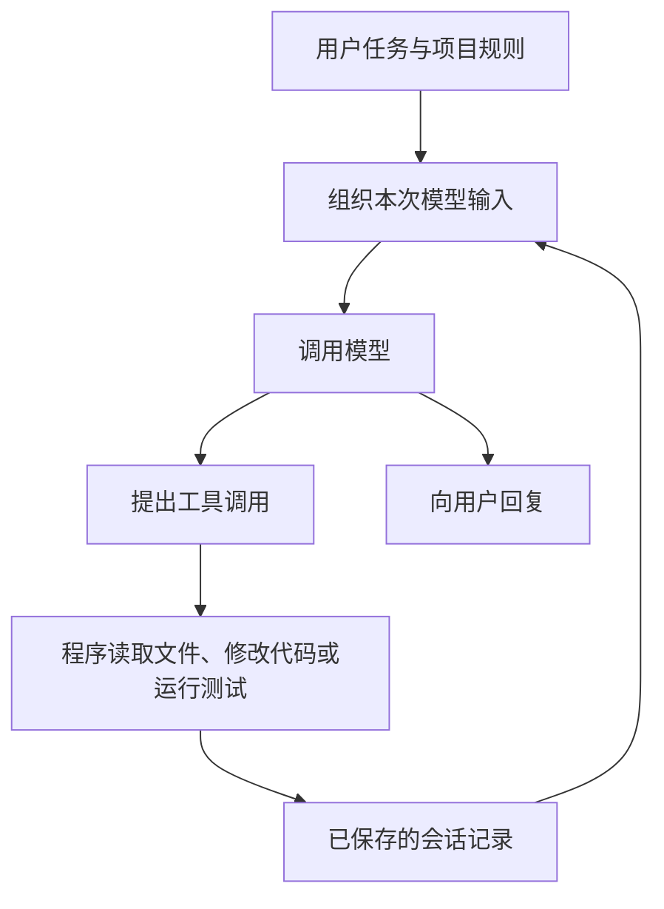

# Agent 的上下文管理：Codex、Claude Code、dsh 与 pi 的机制和算法

假设我们让一个能读文件、改代码的编程助手（coding agent）修复下载模块的失败测试，并要求“不能改变对外接口（API）”。它先读项目规则，查了二十个文件，尝试一种方案，发现会破坏断点续传，于是换了实现。几轮修改后，最近一次测试仍然失败，日志又有几千行。

这时，下一步需要的信息其实很具体：最初的 API 约束、已经排除的方案、当前修改和这次失败的原因。二十份旧文件全文未必还有用，修改前那次“测试通过”的结论甚至可能误导它。

**上下文管理要解决的，就是怎样把继续任务所需的信息，放进下一次模型请求。** 要理解这些策略为什么不同，可以先从 coding agent 怎样工作说起。

## 1. 模型怎样接着上一轮工作

### 一次任务包含很多次模型调用

在这类 coding agent 中，模型根据收到的输入生成回复；它要查看文件或执行测试时，会先提出工具调用，由外围程序执行，再把结果交回模型。负责组织模型调用、执行工具、保存会话和控制重试的这层程序，通常叫作 **harness**。Codex、Claude Code、DeepSeek Harness（下文简称 dsh）和 pi 都有这样一层。



例如，模型先请求读取 `download.ts`，程序把文件内容交回来；模型接着提出修改，再请求运行测试。每次继续调用模型，都需要准备对应的输入。文件虽然在磁盘上，会话虽然保存在日志里，模型这次能用到哪些内容，仍取决于请求中实际包含了什么。

这些输入受**上下文窗口**限制。窗口容量通常用 **token** 计量：它是模型处理文本等内容的单位，与字数没有固定的一一对应关系。项目规则、工具说明、聊天记录、文件内容和测试日志都会占用容量；还要为模型接下来的输出留出空间。工具输出不断增加，把完整历史一直带下去，迟早会超过窗口。

一个直接的办法是把旧内容总结成摘要。这里的“压缩”（compaction）通常会丢失细节：用几段文字替换几万行历史，很难保证以后可能用到的信息都留下。因此，harness 还需要决定哪些原文保留、哪些材料可以重读，以及摘要以后怎样继续工作。

下文比较四个项目处理这些问题的方式。开源项目以固定提交为依据，Claude Code 以官方披露的行为为依据，资料核验日期为 **2026-11-05**；具体版本和证据范围放在[文末](#调研范围与版本)。本文没有运行在线任务评测，机制分析也不代表完成率排名。这里讨论的是 harness 对模型输入的管理，模型内部的 KV cache、注意力算法和权重量化不在本文范围内。

### 保存了什么，这次又给模型看什么

继续看下载模块的例子。完整会话可以留下那次失败方案的文件读取、修改和测试记录，而下一次请求只带一句“方案 A 会破坏断点续传，已放弃”，再加上当前方案的近期原文。旧记录仍然可查，但无需每次原样携带。

这份从历史中选择、替换和整理出来的内容，本文称为**当前工作视图**，在源码中也常被称为上下文“投影”。理解投影，可以先把它看成“根据现有记录，算出模型这次应该看到的消息列表”。它与磁盘上的原记录可以不同：

| 对象         | 在这个任务中可能包含什么                           | 用来做什么               |
| ------------ | -------------------------------------------------- | ------------------------ |
| 持久历史     | 两种方案的消息、工具调用、结果和压缩记录           | 恢复会话、追查、切换分支 |
| 当前工作视图 | 旧方案的结论、当前方案的近期消息                   | 为下一步工作提供依据     |
| 最终请求     | 工作视图加上规则、工具声明，转换成服务端接受的格式 | 实际调用模型             |
| 外部材料     | 当前代码、规则文件、完整测试日志                   | 需要细节时重新读取       |

pi 的 `buildSessionProjection()` 和 dsh 的 session surface 都直接体现了这种区分：原始记录可以留在存储中，模型只看到摘要、保留消息及后来追加的内容。Codex 的 context manager 也维护供请求使用的历史，并在构造请求时处理截断、工具配对和媒体兼容性。[^pi-projection][^dsh-surface][^codex-history]

如果要用一个式子概括这些转换，可以写成：

$$
C_t = \operatorname{Encode}\bigl(\operatorname{Project}(H_t, b_t, e_t), I_t, D_t\bigr)
$$

$H_t$ 是持久历史，$b_t$ 指定当前分支或有效前缀，$e_t$ 是压缩与编辑记录；先据此选出消息，再结合规则和环境信息 $I_t$、工具声明 $D_t$，编码成最终请求 $C_t$。这只是本文的分析抽象，四个项目没有共同实现这样一个接口。后文出现的 provider，指的就是接收请求、提供模型服务的一方。

这个区分也解释了为什么“日志还在”不等于“模型还记得”。同样，保留一句“测试通过”也不够：它对应哪次修改、当前代码是否已经变过，会直接影响下一步判断。

### 留够空间，还要保留完整的消息关系

窗口预算可以粗略写成：

$$
T_{\mathrm{rules}} + T_{\mathrm{tools}} + T_{\mathrm{messages}}
+ R_{\mathrm{output}} + M_{\mathrm{safety}} \le W
$$

前三项分别是规则、工具说明和消息占用的 token；$R_{\mathrm{output}}$ 是回复预算，$M_{\mathrm{safety}}$ 是给估算误差和后续输入留的余量，$W$ 是窗口容量。实际请求还要遵守服务端对推理内容（thinking）、图片和用量统计的记账规则。

这也是为什么压缩一般要提前触发：等窗口完全装满，连“请总结这段历史”的请求本身都可能放不进去。

不过，满足 token 数量限制还不够。工具调用和结果通过 ID 对应，不能当作互不相关的几行文本随意删除：

```text
assistant: 调用 read("config.ts")，call_id = A
tool: A 的文件内容
assistant: 根据文件提出修改
```

只保留结果，服务端可能拒绝这条找不到来源的消息；只保留调用，模型又可能以为工具尚未完成。pi 不让保留区间从 tool result 开始，dsh 检查切点前后的工具配对，Codex 则在请求规范化时补齐缺失结果、清理孤立结果。它们在不同环节处理同一个要求：缩短以后，消息仍要组成一段能继续执行的对话。[^pi-cut][^dsh-pairing][^codex-normalize]

## 2. pi：把旧进展写成摘要，近期工作保留原文

先看 pi，因为它的基本策略比较容易顺着任务理解。下载模块已经读过二十个文件、经历两种方案，下一步仍在处理最近一次测试失败。pi 会尽量保留近期消息的原文，把更早的工作整理成摘要。压缩后的请求大致变成：

```text
当前规则与工具说明
+ 旧进展的摘要：API 约束、方案 A 失败原因、方案 B 已完成的工作……
+ 保留的近期原文：最近修改、测试调用和结果……
+ 此后新增的消息
```

其中摘要列出的内容是这个假设任务需要保留的信息，实际能否完整留下，取决于摘要输入和生成结果。保留近期原文的理由是：模型往往还要接着最近的修改和报错往下查，过早概括它们会丢掉有用细节。

### 2.1 什么时候整理，留下多少原文

pi 用两个独立参数控制这件事。本次快照的默认配置是：

```json
{
  "compaction": {
    "enabled": true,
    "reserveTokens": 16384,
    "keepRecentTokens": 20000
  }
}
```

`reserveTokens` 决定提前多少空间开始压缩。估算的上下文用量超过“窗口容量减去预留量”时触发：

$$
\widehat T_{\mathrm{context}} > W - \texttt{reserveTokens}
$$

`keepRecentTokens` 则决定大约保留多少近期原文。前者控制时机，后者控制切点，两个值都不表示摘要本身必须有多长。本次快照的 `generateSummaryWithUsage()` 已不再用 reserve 值设置摘要输出上限，摘要调用遵守模型输出限制及底层请求预算处理。[^pi-budget][^pi-summary][^pi-output-budget]

为了判断是否快满了，pi 会利用模型服务返回的 **usage**，也就是一次调用对应的 token 用量统计。通常以最近一次有效统计为起点，再估算此后新增消息的体积：

$$
\widehat T_t = U_k + \sum_{i>k}\widehat T(m_i)
$$

这里 $U_k$ 是最近一次有效统计，$m_i$ 是它之后新增的消息。没有有效 usage 时，就估算整个工作视图。文本估算采用字符数近似，因此它适合判断何时压缩，不能直接当作精确 tokenizer 或账单。错误、取消和全零 usage 也不会作为可靠起点。[^pi-budget]

如果这期间删改过上下文，旧统计就未必对应当前输入。比如一大段日志已经退出工作视图，还沿用包含它的用量，会高估压力；反过来，重新加入的内容也可能漏算。因此，`estimateProjectedContextTokens()` 在 usage 之后发生上下文编辑或压缩时，会回退到重新估算。[^pi-budget]

预算检查发生在新 prompt、继续生成下一轮 assistant 回复及运行结束后的恢复路径等位置。工具结果已经返回、模型还要继续工作时，可以先压缩再调用；若工具批次结束后整个 run 已完成，也没有排队消息，就无需为一个不会立即发生的回复做同样检查。[^pi-lifecycle]

### 2.2 怎样选出要总结的旧历史

pi 从最新消息往前累计 token，找到约 `keepRecentTokens` 的保留范围，再把边界调整到合法消息入口，避免拆坏工具调用与结果。主要过程是：

```text
构造当前分支的工作视图
从末尾向前累计 token，选出近期原文
调整切点，避免保留区间从工具结果开始
总结切点之前的历史
把摘要和保留边界写成一条新的压缩记录
```

一个用户请求可能引出很长的一段连续工作：读文件、修改、测试、再修改。若这一段自己就超过近期保留预算，边界只能落在段内。pi 将它称为 **split turn**，分别总结更早历史和当前长段的前半段，再合并摘要。切分仍发生在消息或记录边界，不会把一个工具调用的 JSON 字符串切成两半；源码还把 `bashExecution`、custom 和分支摘要等消息视为可开始工作段的入口。[^pi-cut][^pi-summary]

压缩还会反复发生。下一次通常只需读取“上一版摘要 + 新进入压缩区间的历史”，无需重新处理全部原始记录。这就是递归摘要：最初的 API 约束经过几次压缩以后，能否继续留下，很大程度取决于前几版摘要是否已经保留了它。

pi 也从可识别的 `read`、`write`、`edit` 及 codemode 嵌套调用中提取文件操作，累计形成“读过哪些文件、改过哪些文件”的清单，附在摘要后面。文件范围由程序提取，可以减少模型单靠文字回忆的负担；任意 shell 脚本造成的文件变化则不一定被覆盖。[^pi-serialization]

摘要生成前，输入还会再缩减一次。pi 将消息转成带角色标记的文本，省略 thinking，并把每条工具结果截到前 2,000 个 UTF-16 代码单元，再加截断提示。代码单元是 JavaScript 的字符串计数单位，这里按 `length` 和 `slice()` 处理，既不是 token，也不一定等于读者看到的字符数。[^pi-serialization]

这会影响摘要能保留什么：如果下载测试的真正失败原因只在长日志尾部，后续消息又没有提炼出来，摘要模型可能根本没读到它。此时换一个更强的摘要模型，也补不回未送入请求的内容。

窗口溢出时，pi 还有一条恢复路径。对于选中的失败或可恢复截断响应，先追加 omission 记录，让这条响应退出模型工作视图，再压缩，成功后进行一次 compact-and-retry。若响应本身已经成功完成，只是用量超过配置窗口，则压缩后继续，不重复已完成的响应。这与普通网络重试的区别在于：先改变过大的输入，再尝试继续。[^pi-lifecycle]

### 2.3 摘要装回哪段历史，换方案时又怎样带走进展

上述流程依赖 pi 的会话存储方式。它把 session，也就是会话记录，通过 `id` 和 `parentId` 连成树；当前 leaf 是正在继续的末端节点。沿父节点回溯，就能得到当前方案实际经历的那条路径。

`buildSessionPath()` 取出这条路径，`buildContextEntries()` 找到最近一次 compaction，组合压缩记录、此前仍需保留的尾部和之后的新记录；`buildSessionProjection()` 再应用 `context_edit`，替换或省略指定消息。原始记录无需删除，因此退出模型视图的失败响应仍可用于历史检索、导出或审计。[^pi-projection]

压缩记录还保存边界处完整的 `systemMessage`，包括当时的提示和工具状态。它相当于一个恢复检查点（checkpoint）：重建时用它接上摘要，旧保留范围里的 system entries 不再重复加入。这样，规则和工具状态有单独的恢复依据，无需全靠摘要转述。[^pi-system-checkpoint]

会话树还有另一个用途：回到较早的位置尝试新方案。如果我们放弃下载模块的方案 A，从共同起点探索方案 B，直接换路径会让模型看不到 A 后来失败的原因。`/tree` 可以收集离开分支的工作，生成 `BranchSummaryEntry`，将这段进展带到目标分支：

```text
共同起点 A
├── B：方案一 → C：修改 → D：失败原因
└── E：方案二 → F：继续工作 → [B、C、D 的摘要]
```

分支摘要与窗口太满时的压缩有不同的输入规则：`prepareBranchEntries()` 从新到旧选择消息，`getMessageFromEntry()` 直接跳过 tool result，保留能提取的 assistant 文本、工具调用等材料。因此，只存在于工具结果里的失败依据，也可能没进入分支摘要。[^pi-branch]

这里切换的是对话路径，代码目录不会随之回滚，文件状态仍要交给 Git 等机制管理。两种摘要也各有用途：普通压缩让同一条路径能继续变长，分支摘要让旧方案的经验能被带走。pi 的做法容易理解和扩展，但“近期”只是“可能仍然相关”的近似，递归摘要也会逐步丢失细节。

## 3. dsh：先缩短大段日志，再决定是否需要摘要

假设下载测试输出了几千行日志，其中很多是重复的进度和堆栈。即使窗口压力已经很大，也未必值得马上调用模型，把整段历史重新总结。dsh 把处理分成两步：先用固定规则裁剪工具结果，重新计量；仍然太大时，再生成摘要。

dsh 将当前模型可见的消息列表叫作 **session surface**。可以把它理解为：从持久事件日志出发，把其中的替换记录逐个应用以后，得到的当前工作视图。无论裁剪日志还是用摘要替换旧消息，都通过这套机制表达，并留下来源记录。[^dsh-surface]

### 3.1 便宜的裁剪，有时已经足够

达到压力阈值后，若挂载了 tool-result pruner，dsh 先检查 surface 中的超长工具结果。默认超过 8,192 个 Unicode code point 时，保留开头 4,096、末尾 1,024，中间替换成标记：

```text
工具结果：[前 4096 个码点] [裁剪标记] [后 1024 个码点]
```

这里按 Unicode 码点计数，与 pi 摘要输入按 UTF-16 代码单元截断的单位不同，都不能直接换算成 token。非文本 block 的顺序会保留，替换后的消息也保留原工具调用身份和来源引用。[^dsh-pruner]

裁剪事件写入后，dsh 重新计算用量；如果已低于阈值，就跳过 LLM 摘要。这样既少花一次模型调用，也避免把仍然有用的近期工作过早概括。[^dsh-pressure]

固定规则当然有盲区。如果唯一的报错恰好在日志中间，它也会被裁掉。保留首尾只是可预测的体积控制，没有判断哪些语句与任务最相关，裁剪标记也不保证模型能找回所有原文。

### 3.2 先量准当前输入，才能决定何时处理

要让“两步处理”有效，计数器必须反映裁剪后的消息。dsh 的 `ctx.tokenMeter.measure()` 会结合 surface、请求配置和最近一次有效 usage 计算当前用量。模型路由在这里指选用的服务商与模型；请求 envelope 则包含工具声明、路由及调用配置等信息，它们变化后，旧统计可能不能再复用。

当请求配置相同且 usage 满足复用条件时，主要思想是：

$$
\widehat T_{\mathrm{now}}
= T_{\mathrm{baseline}}
+ \widehat T(S_{\mathrm{now}})
- \widehat T(S_{\mathrm{anchor}})
$$

$T_{\mathrm{baseline}}$ 是基线用量，$S_{\mathrm{anchor}}$ 是基线对应的消息列表，$S_{\mathrm{now}}$ 是当前列表。两者之差可以为负：旧日志被短消息取代，用量就应下降。请求配置不再匹配时，则回退到完整估算。实现还要求服务端 usage 不小于对应锚点的完整估算量，才以它作为基线。[^dsh-meter]

文本按四字符一个 token 加结构开销来估算；声明了图片计量规则的路由，使用对应规则。源码中的 price、pricing 在这里指 token 体积估算，容易被误读为金额。它提供的是内部一致、可随事件重放的压力计量，并非对所有输入运行精确 tokenizer。[^dsh-meter]

触发阈值还要扣掉输出空间和额外余量。令 $W$ 为窗口容量，$O$ 为有效输出预留，$B$ 为额外余量（headroom），$\alpha$ 为触发比例，`resolveCompactSpec()` 计算：

$$
T_{\mathrm{trigger}} = \left\lfloor\min(\alpha W,\ W-O-B)\right\rfloor
$$

默认 $\alpha=0.8$，$B=65,536$。近期原文预算默认是：

$$
K=\left\lfloor 0.16(W-O)\right\rfloor
$$

也可以用绝对值 `retainTokens` 覆盖保留比例。公式中的两个触发约束取较小值，所以“默认 80% 才压缩”并不准确。仅作演示，若 $W=256,000$、$O=32,000$，触发值就是 `158464`，近期保留预算是 `35840`。窗口较小时，还需要调小额外余量，否则扣除后可能没有合法预算。[^dsh-config]

规则文件本身也要占空间。`agent-instructions` 将用户全局规则和项目规则作为持久消息注入，base 配置对两条规则链分别给出 65,536 字节预算；超限时先省略较宽范围的文件，必要时再截断最具体的文件。成功的结构化 `read`、`write`、`edit` 会触发更深目录规则的发现及变化协调，任意 shell 导航不等价于这个刷新入口。也就是说，规则会按作用范围加载，但发现新规则依赖特定的文件操作事件。[^dsh-instructions]

### 3.3 生成摘要以后，怎样可靠地替换旧消息

裁剪仍不足时，dsh 从尾部累计 token，保留近期节点，并将切点向前调整到工具配对平衡的位置。最前面的 system 节点不进入摘要替换区间；后续 system 更新还要结合 agent loop 的当前 system 投影处理。[^dsh-region]

摘要生成完，不能只把新文字追加到日志末尾：它需要在模型视图里占据旧消息的位置。这里有两种顺序：持久事件按序号一直向后追加，模型可见列表则按替换关系排列。

```text
原模型视图：       [10, 11, 12, 13]
追加事件 30：      用摘要替换 10、11
新的模型视图：     [30, 12, 13]
```

数字是事件身份，不是最终阅读顺序。下一次若要总结 `[30, 12]`，应按 surface 中的位置选取，不能筛选“序号从 30 到 12”。`shadowedSeqs` 保存被替换节点的实际顺序。[^dsh-surface]

从开始到提交，主要流程是：

```text
校验区间并取得压缩锁
→ 记录 compaction/start
→ 调用模型生成摘要
→ 检查带包装的摘要确实更短
→ 检查待替换的上下文仍与生成前一致
→ 记录摘要及来源
→ 提交替换消息
→ 记录 compaction/end，释放锁
```

其中 `compaction/summary` 保存摘要、来源和用量，本身不进入对话；真正改变模型视图的是携带 `surfaceOp.replace` 的 `user/message`。检查“仍与生成前一致”，是为了避免摘要生成期间上下文发生变化，旧结果却覆盖了新工作。

自动路径提交前，会比对整个 surface 的节点序列及 token 估算快照；idle 状态下的手动路径只检查选中区间的节点身份、连续性、工具配对和估算量，区间外新追加的内容可以保留。这些是实现实际执行的检查，不是逐字节比较全部内容。`start` 与 `end` 形成应用层的锁协议，中断后可以检测未闭合记录，也不等于磁盘提供覆盖全部事件的数据库事务。[^dsh-region]

### 3.4 超限后，输入真的变小了才重试

服务端返回 `CONTEXT_WINDOW_EXCEEDED` 后，dsh 会绕过普通压力与保留策略，尝试更大的合法缩减。它用 surface 的 replacement generation，也就是替换版本号，判断输入是否已改变；版本确实前进才允许溢出重试，默认上限一次。[^dsh-overflow]

例如，日志裁剪已经成功写入，后面的模型摘要却失败了，当前请求仍然得到了一次有效缩减，可以据此重试；如果整个过程没有改变 surface，把同一个超长请求再发一遍就没有意义。取消信号仍然优先。

切换到较小窗口的模型时，dsh 也会先用目标模型的容量与输出预留检查历史，必要时借助此前路由的摘要能力完成压缩，再接纳新请求配置。这样可以提前处理“大模型放得下，换小模型立刻溢出”的情况。[^dsh-pressure]

这些来源、版本和锁记录让失败后的恢复更容易追查，也增加了实现复杂度。它们仍然解决不了所有容量问题：如果规则、工具声明等固定内容自己就太大，仅压缩旧对话无法让请求装下。

## 4. Codex：交接摘要与远端压缩走不同路径

前面的 pi、dsh 都能从客户端源码看到摘要怎样生成、怎样接回历史。Codex 需要先区分两条路径：一条生成可读的交接摘要；另一条调用服务端的专用压缩能力，返回客户端不能自行解释的压缩状态。实际选择取决于 provider capability、模型配置和功能开关。

此外，本次快照还包含默认关闭的后台压缩实现。它解决的是压缩期间前台怎样继续工作，下文会单独解释，不能据此认定普通会话已经默认在后台整理历史。

### 4.1 交接文字与专用压缩状态

provider 不支持远端 V2 时，Codex 可以走本地 fallback，也就是后备摘要路径。“本地”描述的是由客户端组织流程，摘要仍需要模型生成。客户端把历史和交接提示发给模型，要求保留进展、约束、决定、下一步及关键材料，再据此重建历史。

这里另有约 20,000 token 的近期用户消息保留预算，最后安装摘要和恢复所需的初始上下文。这项预算针对经过分类的用户消息，与 pi 保留任意角色的近期原文不同：同样是“20,000 token”，对应的内容并不一样。[^codex-local]

如果连摘要请求本身都装不下，本地路径会移除较早历史项后再试，直到可接受或已无法继续缩减。对下载模块的例子来说，某份旧读取结果可能在摘要模型看见之前就被移走。这也是提前整理历史的实际理由。

当 provider 声明支持 `RemoteCompactionSupport::V2` 时，客户端改走专用远端路径。它等待完成事件，检查恰好收到一个 compaction 输出项，再按类型和预算保留符合条件的消息、加入 compaction checkpoint，重建后续输入。本次快照的 retained-message 预算常量为 `64000`；developer 消息、部分工具输出等是否原文留下，还受对应开关控制。[^codex-remote]

远端输出是专用的 **compaction item**，可以理解为“下一次请求需要带回服务端的压缩状态”。客户端知道怎样安装和传递它，但不能仅凭其中的加密字段推断服务端如何总结、是否采用某种隐状态压缩算法。源码能确认的边界是调用、返回类型、消息保留规则和安装流程。

公开 Responses API 也有压缩能力，但公共接口的使用契约与开源 harness 的 V2 重建路径需要分别阅读，相关区别放在[附录](#附公共-api-的压缩状态怎样传递)。

### 4.2 先限制输入，再判断是否到达阈值

Codex 在压缩前已经做过多次选择。规则链先读取全局指令，再从项目根目录走向当前目录，每一级按 override、普通 `AGENTS.md`、fallback 的优先级选至多一份。固定源码中的 `project_doc_max_bytes` 默认是 32 KiB，只限制项目规则文件的读取预算；全局和 thread 指令随后合并，最终合计可以超过 32 KiB，并产生提示。[^codex-instructions]

skill 采用按需加载：初始只展示名称、描述和路径，选中后才读正文。当前文档对初始列表另设预算，默认最多占窗口的 2%，窗口未知时使用 8,000 字符限制。这样，很多能力说明可以留在文件里，等任务用到它们时再占用上下文。[^codex-instructions]

工具输出进入 context manager 时，会受截断策略和工具特定预算限制。发送请求前还会处理缺失的调用结果、孤立结果，以及目标模型不支持的图片和音频；用量统计则以已覆盖历史的 provider usage 为基线，再估算后续内容，其中也有针对 reasoning 的记账处理。[^codex-history][^codex-normalize]

所以，“压缩前的原历史”已经是 harness 接纳过的模型材料。追查一次测试究竟返回了什么，需要分清实际执行结果、持久记录和最终送入模型的文本。

自动压缩阈值也有不同统计口径。默认的 `Total` 统计完整活动上下文，通过 `ModelInfo::auto_compact_token_limit()` 取得阈值。窗口已知且显式配置了阈值时，计算为：

$$
A=\min(A_{\mathrm{configured}},\ \lfloor0.9W\rfloor)
$$

未显式配置时，返回 $\lfloor0.9W\rfloor$。此外，完整活动上下文还有按 `effective_context_window_percent` 计算的容量上限，该字段默认是 95%。90% 对应常规自动压缩的触发计算，95% 对应客户端对完整上下文的容量保护，各自用途不同。[^codex-model-budget]

可选的 `BodyAfterPrefix` 则扣除本窗口初始输入的基线，主要统计后来新增的工作正文。这条路径优先读取 `config.model_auto_compact_token_limit`，仅在未配置时回退到上述 helper，因此显式正文阈值不受同一个 90% 截顶；完整活动上下文仍受独立容量上限约束。token-budget fallback 配置还可能增加 buffer，回合结束也有可配置的提前压缩条件。[^codex-window]

这些口径分别在回答不同问题：**当前输入还能不能放下、本窗口是否已积累太多新工作、整个任务累计花了多少资源。** 一个任务可以跑很多轮、累计用掉很多 token，同时每次请求仍保持在较小的窗口内。把三者混在一个累加器里，就无法正确判断压缩时机。

### 4.3 后台摘要不能覆盖刚发生的新工作

同步压缩时，前台需要等待；如果能一边总结旧历史、一边继续执行，等待时间可能缩短。但下载模块的任务也许就在这段时间里又跑了一次测试，用户还补充了“这次只改重试次数”。新信息必须留下。

后台压缩需要记住：它总结的是发出请求那一刻的历史前缀 $P$。生成期间追加的消息记作 $Q$，安装结果应当是：

```text
开始压缩：H = P
前台继续：H = P + Q
候选完成：得到 compact(P)
安装结果：H' = compact(P) + Q
```

Codex 的 async compaction 就按这个思路工作。达到配置的提前阈值时捕获前缀，异步生成候选，安装前检查模型、compaction hash、历史 generation、前缀长度和认证所有者 generation 等条件。这里的 generation 是用于识别状态变化的版本标记。[^codex-async]

实现只替换捕获的前缀，保留后来新增的尾部，并补充新窗口需要的上下文更新；前缀已被不兼容地改写，就拒绝旧候选。单看历史长度无法做到这一点，因为旧消息被替换后，条数也可能完全不变。接上 $Q$ 后还要重新检查预算，必要时再做前台压缩。[^codex-async]

本次快照的 `AsyncCompaction` 默认关闭、要求远端 V2，且与另一条 `TokenBudget` 路径互斥；后者同样处于开发中且默认关闭，会直接启动新窗口。[^codex-flags]

后台策略用额外成本换取较少的前台等待：候选即使最终被丢弃，已经完成的调用仍会产生用量。如果前台增长得太快，安装后仍需再次压缩，实际收益就会变小。它首先需要解决状态一致性，才能谈延迟优化。

## 5. Claude Code：摘要之外，还要重新读取规则与文件

回到下载模块的任务。即使摘要准确写下了“已修改重试逻辑”，模型继续工作时，仍可能需要当前函数的完整代码；最初那句 API 约束，也最好有稳定的来源。Claude Code 的公开资料比较详细地描述了这一步：压缩后，除了摘要，还会重新加载规则、记忆和部分工作文件。

它的证据范围与前三个开源项目不同。本次没有可核验的官方完整运行时源码，以下讨论以官方披露的产品行为为准。

### 5.1 有些材料只在用到时进入窗口

启动时加载的规则、auto memory 索引、skill 描述和 MCP 工具信息，都会与后续对话共同占用窗口。skill 正文按需读取；支持 tool search 的默认路径，也延迟加载完整 MCP schema，即工具名称、参数及其结构说明。[^claude-loop]

子 agent 是另一种控制输入增长的方式。主会话可以把独立调查交出去，只接收结果，少携带原始搜索日志。普通子 agent 使用自己的上下文，fork 则可以继承已有对话。隔离能减少主会话的内容，但结果仍需把关键证据和约束带回来，否则主任务会缺信息。[^claude-loop]

auto memory 负责在会话之外保存可复用知识。`MEMORY.md` 是简短索引，启动时读取前 200 行或前 25KB，以先达到的限制为准；专题文件留在磁盘，等 Claude 需要时再用文件工具读取。这样，跨会话知识可以被编辑和重读，无需每次全部放进窗口。[^claude-memory]

### 5.2 窗口快满会压缩，缓存将过期也可能整理

Claude Code 支持自动压缩、带关注点的 `/compact`，以及对部分历史的 summarize 操作。可以按模型配置的 `autoCompactWindow` 控制压缩位置，实际值还受环境变量和容量限制。官方文档对原生 1M 窗口模型给出的默认位置约为 967K；其他模型、cloud session 和自定义网关有各自条件，不能统一按固定 95% 理解。[^claude-threshold]

此外还有 idle compaction，即空闲时压缩。它面向满足条件的交互会话：已开启自动压缩、使用一小时 prompt cache、上下文达到阈值，且距上次请求约一小时；默认上下文阈值是 200,000 token。系统可以在缓存过期前先整理历史。[^claude-idle]

这里的 prompt cache 会复用相同输入前缀的处理结果，后文会进一步解释其成本影响。对压缩时机来说，关键在于：即使容量还够，若很长的旧前缀即将失去缓存，下次继续携带它也可能需要支付较大的冷输入成本。

### 5.3 继续任务前，把工作材料装回来

官方文档列出的恢复行为包括：从磁盘重新注入根目录规则、auto memory 和计划；路径规则与子目录规则按需重新加载；会话中读过或改过的文件最多重读五个，优先最近修改的文件。超过 5,000 token 的文件则用路径引用代替正文。[^claude-rehydrate]

已调用 skill 也有重新注入预算：每个最多 5,000 token，总计 25,000，超出时先丢较早的 skill。[^claude-rehydrate]

对下载模块来说，摘要告诉模型“工作做到哪里”，重读当前文件提供“代码现在长什么样”，重新加载规则提供“接下来仍须遵守什么”。这几类材料分工不同。文件重读还能减少旧读取结果与当前代码之间的偏差，不需要摘要记住每一行修改。

恢复仍然有边界：按路径加载的规则需要重新命中，大文件只留下路径时，也还需要实际读取正文。公开文档让我们知道有哪些恢复入口和预算，但不足以把整个过程看成所有历史细节都能找回。

Claude API 也提供面向开发者的压缩协议；它与 Claude Code 产品行为属于不同层面的证据，具体返回格式和签名要求放在[附录](#附公共-api-的压缩状态怎样传递)。

## 6. 这些策略怎样配合，成本又从哪里来

用同一个长任务来比较，四者的重点可以整理成下面几项：

| 问题                 | pi                                 | dsh                           | Codex                          | Claude Code                              |
| -------------------- | ---------------------------------- | ----------------------------- | ------------------------------ | ---------------------------------------- |
| 旧历史怎样缩短       | 更新摘要，保留近期原文             | 先裁剪，仍超限再摘要          | 按能力走本地摘要或远端 V2      | 对话摘要，结合工作材料恢复               |
| 当前视图怎样重建     | 沿当前分支应用压缩和编辑记录       | 按事件替换关系生成 surface    | 由 context manager 构造请求    | 官方披露了输入加载与恢复行为             |
| 哪些细节需要特别保护 | 消息切点、工具配对、长工作段       | 配对、替换区间和来源记录      | 消息分类、请求规范化、历史前缀 | 规则、文件与 skill 的恢复预算            |
| 处理超限时的关键检查 | 省略选中的失败响应，压缩后有限重试 | 替换版本前进才允许重试        | 按路径校验结果及安装条件       | 反复填满时停止自动压缩并报错             |
| 后台压缩的证据       | 本文默认路径以同步流程为主         | 本文 basic 路径以同步流程为主 | 有源码实现，默认关闭           | API 有公开方案，产品内部路径据此无法确认 |

Claude Code 对单个巨大输出造成的反复填满，会在若干尝试后停止自动压缩并报告错误，避免陷入“刚压缩就又满了”的循环，文档称其为 thrashing。[^claude-loop]

### 缓存节省重复计算，压缩减少后续输入

前面多次提到 prompt cache。它复用相同输入前缀的计算，减少重复处理成本；模型仍然在那份逻辑输入上生成，所以十万 token 的缓存历史仍会占用上下文容量。OpenAI 的文档建议把稳定内容放在前部，以便共享前缀。任意改写旧消息可能破坏这个可复用的前缀，影响后续成本。[^openai-cache]

因此，一次摘要有两笔需要同时考虑的开销：这次总结旧历史花多少，以及以后多轮请求能少带多少内容。

Claude Code 官方文档描述的做法是复用原来的 system、工具和待总结历史，在尾部追加摘要指令，趁缓存仍热时读取旧前缀。压缩完成后，为较短的新历史重建 conversation cache，system 和项目上下文则可能继续复用。dsh 的 summarizer 也采用类似的前缀重放设计。[^claude-cache][^dsh-summary]

pi 则把消息序列化为独立摘要输入，并设置 `cacheRetention: "none"`，避免为这类一次性请求写入 prompt cache。[^pi-summary]

复用旧前缀可以降低本次摘要的冷读取成本，缩短工作视图可以减少后续携带量，关闭一次性缓存写入则减少另一类开销。比较是否更省，需要合计摘要、失败请求、重读文件和后续轮次的用量，不能只看摘要后的 token 数。

### 近期原文之外，重要状态要有稳定的来源

“保留最近若干 token”容易实现，也常能留下下一步需要的细节。但最初那句“不允许改变公开 API”，可能比最后几轮搜索更重要；刚完成的大段测试输出虽然很新，下一步也未必还需要。

规则重载、文件清单、外部记忆和按需读取，都是对单纯保留近期消息的补充。一个任务若能把接口约束放在项目规则里，把当前实现留在代码里，把完整证据留在可访问的日志中，摘要就主要负责交代进度和指向材料，无需独自承担所有记忆。

下载模块的交接可以具体到这样。以下只是示意，不表示实际执行过这些操作：

```text
目标：修复下载测试，保持公开 API 不变
当前进展：方案 B 已修改重试逻辑，尚未验证通过
排除的方案：方案 A 会破坏断点续传，不再沿用
最近证据：方案 B 修改后的测试仍失败，需要继续定位
待确认：失败来自实现还是测试环境
材料入口：当前代码、失败测试位置、完整日志的路径
```

“改过”“执行过”“通过了”是不同状态。把计划中的测试总结成已经通过，比少留一段普通日志更容易让后续工作走错方向。同样，失败原因若只有一个模糊结论，没有对应文件或日志入口，下一轮也很难确认它是否仍然成立。

## 7. 怎样确认压缩后还能继续做对

压缩率只说明内容少了多少。更直接的检验是：在下载任务的某个确定时刻压缩，之后模型是否仍遵守 API 约束，能否接着当前代码处理失败，而不重试已排除的方案。

可以围绕这些问题观察：

| 观察项       | 要回答的问题                                 |
| ------------ | -------------------------------------------- |
| 约束保留     | 最早的关键限制在一次、多次压缩后是否仍被遵守 |
| 工作状态     | 能否区分已完成、失败与待验证事项             |
| 重复劳动     | 是否重做搜索、重复读取或重试旧失败方案       |
| 请求结构     | 工具调用是否成对，格式是否符合服务端协议     |
| 状态新鲜度   | 文件与测试结论是否对应当前工作区             |
| 总成本与等待 | 原任务、摘要、失败请求和重读合计花了多少     |

比较不同策略时，需要固定模型、任务、工具环境和工作预算，再分别调整压缩阈值、保留窗口与摘要方式，并多次运行。否则，一次完成率差异可能来自模型、工具或采样，难以归因于上下文管理。

还有一些正确性可以不用在线模型验证。本文读到的测试包括：pi 验证 context edit 只改变模型投影，编辑后旧 usage 不能继续作为锚点；dsh 验证裁剪足够时不调用摘要、不缩短的摘要被拒绝、无有效替换时不做溢出重试；Codex 验证过期后台前缀会被拒绝，即使历史长度仍然足够。本文核对了这些测试，没有在三个外部项目中执行整套测试。[^pi-tests][^dsh-tests][^codex-tests]

自己实现时，可以先把这条最基本的路径接完整：保留可追查的历史，构造本次工作视图，限制工具输出，检查预算，在合法边界缩减旧内容，随后恢复规则与当前材料并重新计量。后台处理再额外保证只替换实际总结的前缀，超限重试则要求输入已经有效缩减。

摘要总是在近似表达“继续任务需要知道什么”，而我们无法提前知道下一步会用到哪一条细节。对长任务更可靠的安排，是让模型既能从摘要接上进度，也能回到规则、当前代码和执行记录中确认事实。窗口变大能推迟整理的时机，这些恢复入口仍然需要设计。

## 附：公共 API 的压缩状态怎样传递

这一节面向需要自己接模型 API 的读者。它讨论应用如何传递压缩结果，与前面的产品使用和源码路径分开看。

### OpenAI Responses API

公开压缩文档要求把压缩状态视为不透明对象。独立 `/responses/compact` 返回的完整 window 是下一次请求的规范输入，客户端应原样传递；通过 `context_management` 开启服务端自动压缩，则有另一套连续请求流程。这些是公共 API 的使用契约，不能直接代替开源 Codex harness 当前 V2 的消息保留和重建逻辑。[^openai-compaction]

### Claude API

截至本文调研，Claude API 同时提供规则驱动的 context editing 和摘要式 compaction。前者可以清除旧工具结果、旧 thinking；后者包括按阈值压缩和 on-demand 压缩。API 参数存在，只能确认开发者可调用这些能力，无法据此还原 Claude Code 全部内部路径。[^claude-editing][^claude-api-overview]

on-demand beta 使用 `compact-2026-09-04`，请求中提交 `compaction: {"type": "summarize"}`。成功时返回包含可读文本与签名的 compaction block，后续需原样传递，用它替代已总结的前缀。摘要虽然可读，也不能改写文字后继续沿用旧签名。[^claude-api-demand]

摘要请求的历史本身仍须装进模型窗口，未完成的工具调用也要先补齐结果。HTTP 200 不保证已经生成摘要，调用方还需检查 `stop_reason` 和实际 block，再决定是否替换历史。[^claude-api-demand]

应用也可以自行安排后台请求：生成期间继续原会话，结果回来后只替换它覆盖的前缀，保留之后的新消息。对支持 preserved thinking 的模型，保留消息里的 thinking 是否仍有效，还受 system、工具及所绑定前缀等条件影响，不能仅凭可见文字相同就任意搬运。[^claude-api-background][^claude-api-thinking]

这里可以比较的是压缩结果的返回形式：前文 Codex 远端路径使用不透明的 compaction item，Claude API 则提供可读摘要与签名。两者服务端内部究竟怎样压缩，都无法仅靠客户端返回格式完全推导。

## 调研范围与版本

资料核验日期为 **2026-11-05**。三个开源项目均下载固定提交的源码，沿上下文构造、压缩、持久化和重试路径阅读，并核对相关测试。本文没有运行在线模型任务评测，文中的取舍分析不构成完成率排名。

| 对象        | 本文固定的依据                                                                                                                         | 证据范围                                                                         |
| ----------- | -------------------------------------------------------------------------------------------------------------------------------------- | -------------------------------------------------------------------------------- |
| Codex       | [`ba057e43758c`](https://github.com/openai/codex/tree/ba057e43758cb19beead2af9df19d10756cc4100)                                        | 客户端源码可检查；远端压缩状态的内部编码未公开                                   |
| dsh         | [`fcc0ad462172`](https://github.com/deepseek-ai/deepseek-harness/tree/fcc0ad462172522aaf5c93a7b2e01f6b9f0b0159)，版本字段 `0.2.2-rc.1` | token meter、裁剪、摘要和事件替换源码可检查                                      |
| pi          | [`386db6130e42`](https://github.com/earendil-works/pi/tree/386db6130e42e1035640782e35bfb98a59fd9904)，coding-agent 版本字段 `1.5.0`    | 以 `AgentSession` 对接的 coding-agent 路径为主                                   |
| Claude Code | 当日官方产品文档、工程文章及 Claude API 文档                                                                                           | 本次未获得可核验的官方完整运行时源码；只描述披露的行为，不据此补造内部函数与算法 |

主分支提交不等于已发布版本，功能开关也会改变实际路径。例如，本文 Codex 快照中的后台压缩仍处于开发阶段，源码默认关闭。本文涉及的 Claude API beta 功能，也不自动等于 Claude Code 正在使用的内部协议。

已有的 [Pi 上下文管理笔记](./pi-context-management)和 [DeepSeek Harness 整体调研](./deepseek-harness-codebase-research)保留了较早的版本观察。本文中的数值和流程以本次快照为准。

## 源码与文档

下面的源码链接均固定到本文调研提交。官方文档为动态页面，数值和功能状态应结合本次调研日期阅读。

[^pi-projection]: pi [`session-manager.ts`：`buildContextEntries`、`projectContextEntry`、`buildSessionProjection`](https://github.com/earendil-works/pi/blob/386db6130e42e1035640782e35bfb98a59fd9904/packages/coding-agent/src/core/session-manager.ts#L469-L584)。

[^pi-system-checkpoint]: pi [`CompactionEntry.systemMessage`](https://github.com/earendil-works/pi/blob/386db6130e42e1035640782e35bfb98a59fd9904/packages/coding-agent/src/core/session-manager.ts#L91-L104)、[`压缩记录转为上下文消息`](https://github.com/earendil-works/pi/blob/386db6130e42e1035640782e35bfb98a59fd9904/packages/coding-agent/src/core/session-manager.ts#L460-L464)和[`appendCompaction()`](https://github.com/earendil-works/pi/blob/386db6130e42e1035640782e35bfb98a59fd9904/packages/coding-agent/src/core/session-manager.ts#L1271-L1296)。

[^pi-output-budget]: pi [`simple-options.ts`：模型输出上限与按剩余窗口收缩](https://github.com/earendil-works/pi/blob/386db6130e42e1035640782e35bfb98a59fd9904/packages/ai/src/api/simple-options.ts#L15-L60)。

[^pi-budget]: pi [`compaction.ts`：默认参数、usage 估算与触发判断](https://github.com/earendil-works/pi/blob/386db6130e42e1035640782e35bfb98a59fd9904/packages/coding-agent/src/core/compaction/compaction.ts#L120-L271)。

[^pi-cut]: pi [`compaction.ts`：合法切点](https://github.com/earendil-works/pi/blob/386db6130e42e1035640782e35bfb98a59fd9904/packages/coding-agent/src/core/compaction/compaction.ts#L351-L410)与[`投影后的切点及 prepareCompaction`](https://github.com/earendil-works/pi/blob/386db6130e42e1035640782e35bfb98a59fd9904/packages/coding-agent/src/core/compaction/compaction.ts#L789-L923)。

[^pi-summary]: pi [`摘要请求与输出处理`](https://github.com/earendil-works/pi/blob/386db6130e42e1035640782e35bfb98a59fd9904/packages/coding-agent/src/core/compaction/compaction.ts#L595-L751)和[`compact()` 的 split-turn 摘要合并](https://github.com/earendil-works/pi/blob/386db6130e42e1035640782e35bfb98a59fd9904/packages/coding-agent/src/core/compaction/compaction.ts#L952-L1058)。

[^pi-serialization]: pi [`utils.ts`：文件操作提取、累计清单、工具结果截断与 thinking 省略](https://github.com/earendil-works/pi/blob/386db6130e42e1035640782e35bfb98a59fd9904/packages/coding-agent/src/core/compaction/utils.ts#L18-L155)。

[^pi-lifecycle]: pi [`agent-session.ts`：prepareNextTurn 接入](https://github.com/earendil-works/pi/blob/386db6130e42e1035640782e35bfb98a59fd9904/packages/coding-agent/src/core/agent-session.ts#L915-L958)、[`运行后的压缩与恢复`](https://github.com/earendil-works/pi/blob/386db6130e42e1035640782e35bfb98a59fd9904/packages/coding-agent/src/core/agent-session.ts#L3050-L3200)；[固定版本 compaction 文档](https://github.com/earendil-works/pi/blob/386db6130e42e1035640782e35bfb98a59fd9904/packages/coding-agent/docs/compaction.md)。

[^pi-branch]: pi [`branch-summarization.ts`：共同祖先、条目收集与预算准备](https://github.com/earendil-works/pi/blob/386db6130e42e1035640782e35bfb98a59fd9904/packages/coding-agent/src/core/compaction/branch-summarization.ts#L104-L263)。

[^dsh-surface]: dsh [`session surface`](https://github.com/deepseek-ai/deepseek-harness/blob/fcc0ad462172522aaf5c93a7b2e01f6b9f0b0159/packages/core/session/src/surface.ts)和[`compaction 事件契约`](https://github.com/deepseek-ai/deepseek-harness/blob/fcc0ad462172522aaf5c93a7b2e01f6b9f0b0159/docs/subsystems/compaction.md)。

[^dsh-instructions]: dsh [`agent-instructions` 的加载、分链预算与刷新行为](https://github.com/deepseek-ai/deepseek-harness/blob/fcc0ad462172522aaf5c93a7b2e01f6b9f0b0159/packages/context/agent-instructions/README.md)。

[^dsh-pairing]: dsh [`tool-pairing.ts`](https://github.com/deepseek-ai/deepseek-harness/blob/fcc0ad462172522aaf5c93a7b2e01f6b9f0b0159/packages/compaction/compaction/src/tool-pairing.ts)。

[^dsh-meter]: dsh [`TokenMeter.measure()`](https://github.com/deepseek-ai/deepseek-harness/blob/fcc0ad462172522aaf5c93a7b2e01f6b9f0b0159/packages/llm/token-meter/src/index.ts#L133-L203)与[`字符及结构估算`](https://github.com/deepseek-ai/deepseek-harness/blob/fcc0ad462172522aaf5c93a7b2e01f6b9f0b0159/packages/llm/token-meter/src/estimate.ts)。

[^dsh-config]: dsh [`config.ts`：默认值与 resolveCompactSpec](https://github.com/deepseek-ai/deepseek-harness/blob/fcc0ad462172522aaf5c93a7b2e01f6b9f0b0159/packages/compaction/compaction-basic/src/config.ts#L67-L225)。

[^dsh-pruner]: dsh [`裁剪参数与码点计数`](https://github.com/deepseek-ai/deepseek-harness/blob/fcc0ad462172522aaf5c93a7b2e01f6b9f0b0159/packages/compaction/compaction-tool-result-pruner/src/config.ts)和[`pruneContent / pruneSession`](https://github.com/deepseek-ai/deepseek-harness/blob/fcc0ad462172522aaf5c93a7b2e01f6b9f0b0159/packages/compaction/compaction-tool-result-pruner/src/index.ts#L76-L181)。

[^dsh-pressure]: dsh [`compactPressure()`](https://github.com/deepseek-ai/deepseek-harness/blob/fcc0ad462172522aaf5c93a7b2e01f6b9f0b0159/packages/compaction/compaction-basic/src/index.ts#L315-L371)和[`模型切换与能力边界`](https://github.com/deepseek-ai/deepseek-harness/blob/fcc0ad462172522aaf5c93a7b2e01f6b9f0b0159/packages/compaction/compaction-basic/README.md)。

[^dsh-region]: dsh [`region.ts`：区间选择、稳定性检查、缩减校验和事件提交](https://github.com/deepseek-ai/deepseek-harness/blob/fcc0ad462172522aaf5c93a7b2e01f6b9f0b0159/packages/compaction/compaction-basic/src/region.ts#L117-L542)。

[^dsh-overflow]: dsh [`agent/request-error` 的 generation 检查与有限重试](https://github.com/deepseek-ai/deepseek-harness/blob/fcc0ad462172522aaf5c93a7b2e01f6b9f0b0159/packages/compaction/compaction-basic/src/index.ts#L205-L257)。

[^dsh-summary]: dsh [`summarizer.ts`：原前缀重放、尾部指令与 checkpoint 内容](https://github.com/deepseek-ai/deepseek-harness/blob/fcc0ad462172522aaf5c93a7b2e01f6b9f0b0159/packages/compaction/compaction-basic/src/summarizer.ts#L24-L195)。

[^codex-history]: Codex [`context_manager/history.rs`：工具输出接纳、请求投影与 token 估算](https://github.com/openai/codex/blob/ba057e43758cb19beead2af9df19d10756cc4100/codex-rs/core/src/context_manager/history.rs#L665-L1196)。

[^codex-instructions]: OpenAI 官方 [AGENTS.md 的发现规则](https://learn.chatgpt.com/docs/agent-configuration/agents-md#how-codex-discovers-guidance)和[Skills 的渐进披露及初始列表预算](https://learn.chatgpt.com/docs/build-skills)。预算范围以固定源码为准：[`load_project_instructions()` 只扣除项目文件预算](https://github.com/openai/codex/blob/ba057e43758cb19beead2af9df19d10756cc4100/codex-rs/core/src/agents_md.rs#L57-L110)，[`AgentsMdManager` 合并全局、thread 指令并检查合计大小](https://github.com/openai/codex/blob/ba057e43758cb19beead2af9df19d10756cc4100/codex-rs/core/src/agents_md_manager.rs#L127-L148)。

[^codex-normalize]: Codex [`normalize.rs`：补齐结果与清理孤立输出](https://github.com/openai/codex/blob/ba057e43758cb19beead2af9df19d10756cc4100/codex-rs/core/src/context_manager/normalize.rs)。

[^codex-model-budget]: Codex [`ModelInfo` 的窗口与自动阈值](https://github.com/openai/codex/blob/ba057e43758cb19beead2af9df19d10756cc4100/codex-rs/protocol/src/openai_models.rs#L568-L590)；[`effective_context_window_percent` 默认值](https://github.com/openai/codex/blob/ba057e43758cb19beead2af9df19d10756cc4100/codex-rs/protocol/src/openai_models.rs#L413-L415)。

[^codex-window]: Codex [`session/context_window.rs`：两种范围的阈值读取与完整窗口约束](https://github.com/openai/codex/blob/ba057e43758cb19beead2af9df19d10756cc4100/codex-rs/core/src/session/context_window.rs#L53-L119)；[`AutoCompactTokenLimitScope` 默认值](https://github.com/openai/codex/blob/ba057e43758cb19beead2af9df19d10756cc4100/codex-rs/protocol/src/config_types.rs#L47-L55)。

[^codex-local]: Codex [`compact.rs`：本地请求、溢出处理和历史重建](https://github.com/openai/codex/blob/ba057e43758cb19beead2af9df19d10756cc4100/codex-rs/core/src/compact.rs)；[`交接提示`](https://github.com/openai/codex/blob/ba057e43758cb19beead2af9df19d10756cc4100/codex-rs/prompts/templates/compact/prompt.md)。

[^codex-remote]: Codex [`远端 V2 结果收集与保留规则`](https://github.com/openai/codex/blob/ba057e43758cb19beead2af9df19d10756cc4100/codex-rs/core/src/compact_remote_v2.rs#L385-L613)、[`retained-message 预算`](https://github.com/openai/codex/blob/ba057e43758cb19beead2af9df19d10756cc4100/codex-rs/core/src/compact_remote_v2.rs#L90-L95)及[`分路径调度`](https://github.com/openai/codex/blob/ba057e43758cb19beead2af9df19d10756cc4100/codex-rs/core/src/session/turn.rs#L1637-L1745)。

[^openai-compaction]: OpenAI 官方 [Compaction](https://developers.openai.com/api/docs/guides/compaction)，区分服务端自动压缩和独立 compact endpoint 的返回处理。

[^codex-flags]: Codex [`TokenBudget 开关`](https://github.com/openai/codex/blob/ba057e43758cb19beead2af9df19d10756cc4100/codex-rs/features/src/lib.rs#L2182-L2187)、[`AsyncCompaction 开关`](https://github.com/openai/codex/blob/ba057e43758cb19beead2af9df19d10756cc4100/codex-rs/features/src/lib.rs#L2344-L2349)和[`token-budget 新窗口路径`](https://github.com/openai/codex/blob/ba057e43758cb19beead2af9df19d10756cc4100/codex-rs/core/src/compact_token_budget.rs)。

[^codex-async]: Codex [`async_compaction.rs`：启动与候选校验](https://github.com/openai/codex/blob/ba057e43758cb19beead2af9df19d10756cc4100/codex-rs/core/src/session/async_compaction.rs)、[`前缀安装与 suffix 保留`](https://github.com/openai/codex/blob/ba057e43758cb19beead2af9df19d10756cc4100/codex-rs/core/src/session/mod.rs#L4690-L4762)和[`候选安装后的预算复查`](https://github.com/openai/codex/blob/ba057e43758cb19beead2af9df19d10756cc4100/codex-rs/core/src/compact_remote_v2_installation.rs#L15-L71)。

[^claude-loop]: Claude Code 官方 [How Claude Code works](https://code.claude.com/docs/en/how-claude-code-works#the-context-window)，包括按需加载、子 agent 与 thrashing 处理。

[^claude-memory]: Claude Code 官方 [Auto memory 的存储与加载](https://code.claude.com/docs/en/memory#how-it-works)。

[^claude-threshold]: Claude Code 官方 [Context window and auto-compaction](https://code.claude.com/docs/en/model-config#context-window-and-auto-compaction)。

[^claude-idle]: Claude Code 官方 [`idleCompaction`](https://code.claude.com/docs/en/settings-reference#idlecompaction)。

[^claude-rehydrate]: Claude Code 官方 [What survives compaction](https://code.claude.com/docs/en/context-window#what-survives-compaction)。

[^claude-editing]: Claude API 官方 [Context editing](https://platform.claude.com/docs/en/build-with-claude/context-editing)。

[^claude-api-overview]: Claude API 官方 [Compaction overview](https://platform.claude.com/docs/en/build-with-claude/compaction)。

[^claude-api-demand]: Claude API 官方 [Compaction on demand](https://platform.claude.com/docs/en/build-with-claude/compaction-on-demand#how-on-demand-compaction-works)。

[^claude-api-background]: Claude API 官方 [Compaction in the background](https://platform.claude.com/docs/en/build-with-claude/compaction-background)。

[^claude-api-thinking]: Claude API 官方 [Compaction and preserved thinking](https://platform.claude.com/docs/en/build-with-claude/compaction-thinking-blocks)。

[^claude-cache]: Claude Code 官方 [Compacting the conversation 与缓存](https://code.claude.com/docs/en/prompt-caching#compacting-the-conversation)。

[^openai-cache]: OpenAI 官方 [Prompt caching](https://developers.openai.com/api/docs/guides/prompt-caching)。

[^pi-tests]: pi [`session-context-edit.test.ts`](https://github.com/earendil-works/pi/blob/386db6130e42e1035640782e35bfb98a59fd9904/packages/coding-agent/test/session-context-edit.test.ts)。

[^dsh-tests]: dsh [`compaction-basic.spec.ts`](https://github.com/deepseek-ai/deepseek-harness/blob/fcc0ad462172522aaf5c93a7b2e01f6b9f0b0159/packages/compaction/compaction-basic/tests/compaction-basic.spec.ts)。

[^codex-tests]: Codex [`compact_remote_v2_installation_tests.rs`](https://github.com/openai/codex/blob/ba057e43758cb19beead2af9df19d10756cc4100/codex-rs/core/src/compact_remote_v2_installation_tests.rs)。
